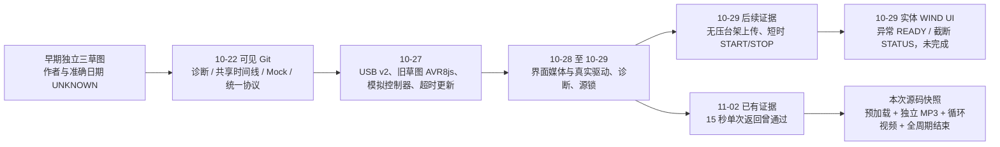
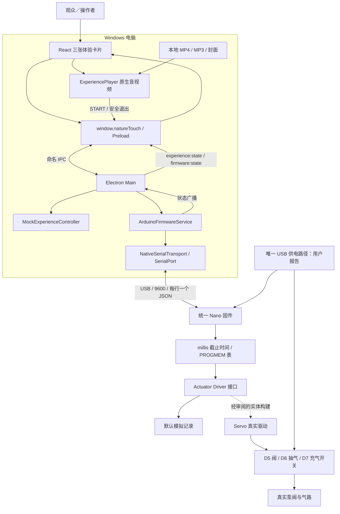
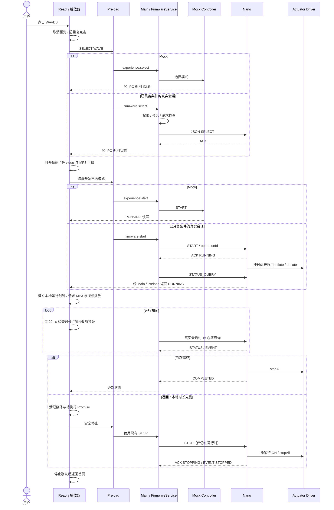
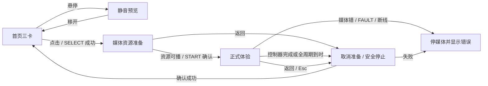
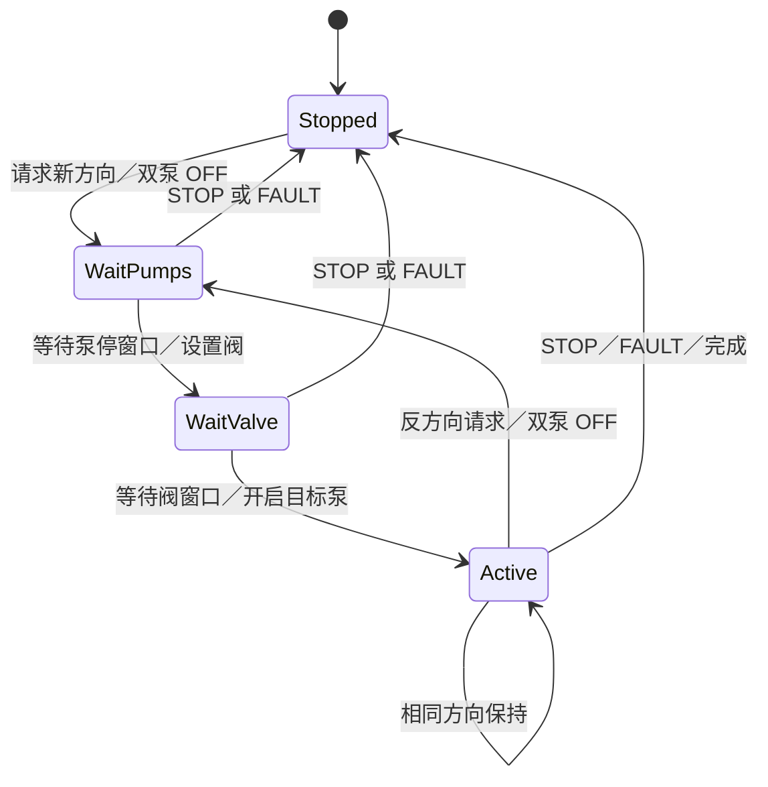
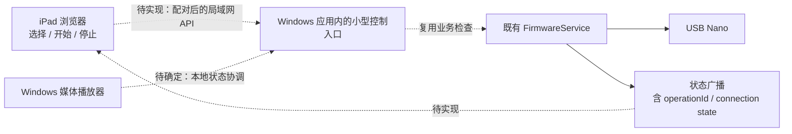

# Nature Touch — 项目完整理解与架构分析

审阅日期：2026-11-02，Asia/Tokyo。读者：产品设计负责人及后续接手开发者。

**本报告解释当前工作区，不修改系统。** 本次仅阅读源码、Git、已有日志／产物及官方开源资料；没有运行应用或测试、枚举／打开 COM、上传固件、操作泵阀、安装依赖或提交 Commit。本文是审查结果，不是新的硬件操作授权。

## 00. 一页看懂 Nature Touch

### 00.1 它到底是什么

Nature Touch 把“看到自然画面、听到环境声音、感到气囊变化”放进同一次体验。Windows 电脑运行界面和媒体，Arduino 按一张动作时间表请求阀门、抽气泵和充气泵工作。USB 同时承担目前装置的供电与串口通信；电脑发送的是“选模式／开始／停止”，不是逐帧遥控引脚。

可以把它理解为：**React 是观众看到的舞台，Electron 是电脑端的接线与调度人员，Arduino 是按时间表执行动作的现场控制器。** 媒体播放和气动动作由不同执行环境完成，拥有相同模式名称，不等于已经拥有同一个精确时钟。[首页:177][ui-select]、[主进程:175][main-start]、[固件:525][fw-action]

### 00.2 目前处于什么位置

目前处于“桌面体验软件已实现、统一控制器已有模拟与有限实体台架证据，但最终展览交付尚未闭环”的阶段。不能再概括成“只有模拟”，也不能概括成“整套真实展览已通过”。

| 对象 | 当前能确认的事实 | 不能据此推导什么 |
|---|---|---|
| 工作区默认固件 | 选择模拟驱动；真实构建由 `CONFIGURATION_VERIFIED` 阻止 | 不能推导 Nano 当前 Flash 也是这份源码 |
| 默认 Electron 启动 | 正式实体权限为 false；Mock 与明确解锁的隔离模拟路径仍存在 | 不能推导所有启动方式都禁止实体控制 |
| `--open-air-bench` 特殊启动 | 主进程存在已审阅台架配置入口，允许已识别真实固件走现有控制 API | 不代表气囊连接／有压展览已获得许可 |
| 最近找到的上传记录 | 2026-10-29 上传并校验过 open-air bench HEX | 不代表 2026-11-02 板上版本已被本次重新读取 |
| 最近找到的实体 UI 完整运行记录 | WIND START 后出现异常串口流，未完成 24 秒验收 | 不能用更早的模拟 PASS 覆盖该实体失败 |
| iPad | 当前没有 Windows 远程控制服务 | 浏览器能显示页面不等于能控制 USB Nano |

依据：[驱动选择:4][driver-select]、[真实配置:20][real-config-l20]、[主进程:18][main-gates]、[台架发布记录][bench-release]、[实体 WIND 失败记录][real-wind-failure]。

### 00.3 阅读前最重要的版本提醒

**当前播放器与本聊天此前“15 秒单次播放后返回”的实现不是同一版本。** 本次实际读取的 `ExperiencePlayer.tsx`：

- 正式 `<video>` 带 `muted` 和 `loop`，不使用视频内嵌声音作为正式音源。
- 单独 `<audio>` 播放对应 MP3。
- 准备好媒体后 START，然后立即启动音视频流程；当前播放器没有等待 5000／4420 ms 音频标记。
- 返回条件主要是控制器时长 24000／25000／27420 ms 到达，或收到 COMPLETED／STOPPING；没有视频 `ended → 返回` 的处理。
- 没有播放／暂停按钮，也没有页面内独立 Stop 按钮；“もどる”和 Esc 仍调用停止流程。

这不是对历史聊天的重新解释，而是当前源码与已有旧验收结果之间的差异。本文只记录，不擅自恢复任一版本。[播放器:162][p-sync]、[播放器:222][p-prepare]、[播放器:306][p-view]、[旧单次播放结果][single-evidence]

### 00.4 证据怎么读

| 标记 | 含义 | 示例 |
|---|---|---|
| S：源码事实 | 本次直接读取当前文件可确定 | 当前 video 的 `loop` 属性存在 |
| H：历史记录 | 文档／Commit 记载某时发生过 | 10-27 更新模拟固件后 HOST_TIMEOUT 通过 |
| T：测试证据 | 有具体结果文件／日志，必须同时看版本与测试环境 | AVR8js 执行 HEX，或 Mock IPC 检查 |
| O：实体观察报告 | 用户或操作者报告实际现象 | STOP 后听到阀切换、两台泵停止 |
| U：未知 | 缺少足够证据 | 意外 READY 的电气根因、现在板上 Flash |
| P：建议 | 本报告提出的未来方向，尚未实施 | iPad 经 Windows 局域网 API 控制 |

Git 当前 HEAD 为 `1ffce6c`（2026-10-28）。大量 10-29 之后的实现、发布目录与测试文件仍是已修改／未跟踪工作区内容，**不能只读 HEAD 就描述现在**。Git 作者名是提交者信息，不是原始 Arduino 程序作者证明。远端是否包含这些改动，本次未 fetch，UNKNOWN。

本报告源码快照的 SHA-256：

```text
ExperiencePlayer.tsx
7a93cd99dc1a46e89fc2b6b97150703d0ce0aeba3f34300ab573df0cc66d617b
ExhibitionHome.tsx
6026d0b5a3026286db4a47903af81fd5a416ab73367a38925b91d7747506ea35
arduino-firmware-service.ts
a440afdc6b98b4abe919633f3a1e91fbe5d59f23849c2720e5c2723fe02983a4
nature_touch_unified.ino
47d22ea888bccafe6cc2469b9eb76da2fc115658df4dbd1353a20e78b31fe823
real-actuators.h（工作副本）
b324447b262ea071fe218571e9f1510cd55fd14c32b6061cca803b5ffa21c8bb
experience-timelines.h
8e1dac9eff6e246b88b7a99c54baeeed096bdc4ae5e780780fed7649ab69cbff
```

工作区可能继续变化；行号和判断以这组快照为准。本次看到构建目录中也有 `starting-media` 等新流程文本，但构建文件存在不等于本次已对它执行验收。

**本章最重要的三个概念：** ①源码／产物／板上固件不同；②软件状态不是物理测量；③测试结论属于特定版本和环境。

**我应该理解的关键关系：** UI 可正常播放、USB 协议正常、泵阀真实动作正常、气囊展览安全，是四层不同的完成度。

**后续需要进一步检查的问题：** 最终体验要 15 秒媒体驱动，还是保留完整气动周期？先确定这项产品契约，再决定修改方向。

## 01. 从过去到现在：项目演进史

### 01.1 历史能还原到什么程度

最早可见正式 Commit 是 `9cb568b`，日期 2026-10-22，标题为 “Add Nature Touch project and Phase 2A work”；`8e2df49` 同日记录 Phase 2B；`d192caa` 在 10-27 发布后续集成。之后大量 Commit 是 Agent 会话检查点，不能把每条都当独立功能版本。原草图目录中的 `sep30`／`oct21` 是文件命名线索，不能当作已证实的创作日期。

用户历史说明朋友参与过旧程序；但草图没有足够署名和创作记录，最早作者、协作分工、最初实物演示日期均无法独立确认。以下早期顺序按“原草图 → 设计文档 → 可见 Commit → 结果记录”重建；未得到准确日期的部分明确保留 UNKNOWN。

### 01.2 A：独立 Arduino 原型

**原来的做法。** WIND、WAVE、BUBBLE 是三份独立 `.ino`，每次板上运行其中一份。`setup()` 绑定 D5/D6/D7，`loop()` 自动反复调用 `inflate(ms)` 和 `deflate(ms)`；函数写三个 Servo 值，再 `delay(ms)`。串口打印 “PLAY … AUDIO NOW” 是给外部人员／程序看的提示，并不能在 Nano 上播放 MP3。[WIND:18][legacy-wind]、[WAVE:21][legacy-wave]、[BUBBLE:36][legacy-bubble]

**遇到的问题。** 它能直接演示已经调好的动作，但不能由展览 UI 在三个模式间自由切换；循环与阻塞延时也没有为串口即时 STOP、操作身份或故障恢复留出机制。

**为什么修改。** 展览需要观众选择、单次运行、取消、故障后等待人工决定，而不是插电就无限循环。

**修改了什么。** 把每次动作和时长抽成共享定义与固件表，再建立接受指令的统一控制器。

**当前保留什么。** 原草图未作为生产入口继续改造；它们作为校准来源保留。顺序、整数时长、末段 5／5／3 秒抽气及 BUBBLE 两次连续充气被保留下来。原注释不总等于实际执行结果：例如 WIND 的周期应按 `delay()` 相加计算，而不能仅靠 `WIND_LENGTH` 变量名判断。[共享定义:67][definitions]、[PROGMEM 表:12][timelines]

### 01.3 B：统一控制器与 Protocol v2

**原来的做法。** 最初电脑与 Nano 的诊断仅有 PING／PONG 和文本 STATUS；Phase 2A 首先把体验状态机放在电脑 Mock 中，Protocol v2 当时还是后续协议设计。[Phase 1B][h-serial]、[Phase 2A][h-control]

**遇到的问题。** 普通文本“收到一行回应”难以说明是哪次操作、是否重复执行、现在是否还在运行。旧控制器没有最新 HOST_TIMEOUT 时，本地源码更新也不会自动更新 Nano Flash。

**为什么修改。** 让每次请求有 `requestId`，每轮体验有 `operationId`，设备能拒绝错误状态、关联回应，并在主机消失时取消运行。

**修改了什么。** Phase 2B 已有统一模拟固件及 Electron 服务；Phase 2D 有物理 USB 的协议验证。随后加入模拟执行器接口、协作式串口输出、5000 ms 主机租约、FAULT 与 RECOVER。实际协议名是 IDENTIFY／SELECT／START／STOP／STATUS_QUERY／RECOVER，不是早期提案里的 PREPARE／CANCEL／STARTED。[固件:632][fw-command-l632]、[统一控制器报告][h-unified]

**当前保留什么。** 非阻塞调度、五个控制状态、四项请求缓存和四项操作历史。Simulation Only 使电脑指令、状态及时间线可以先验证，而不依赖未知电子开关的 OFF 行为；它不是“实物已安全”的标签。

**重要实际历史。** 10-27 的固件更新记录中，旧板在超过 6 秒无请求后仍 RUNNING；上传新版模拟 HEX 后观察到 HOST_TIMEOUT、elapsedMs=5001。该记录支持“旧板上程序造成差异”，但未回读旧 Flash，不能断言旧二进制逐字等于某个 Commit。[固件更新报告][h-update]

### 01.4 C：真实驱动与硬件整合

**原来的做法。** 旧角度值曾产生气动运动，但电气 ON／OFF、失信号、复位和气路含义没有被源码证明。

**遇到的问题。** 同一个 `Servo.write(0)` 对不同模块未必等于 OFF；阀的 OFF 更不等于气囊可靠泄压。D7 曾有“PWM 移除停泵，但 RESET 时继续运行”的用户报告，后来又有特定条件 RESET 通过的报告，不能删除任一段历史。[早期 RESET 分析][h-reset]、[最新用户 RESET 报告][o-reset]

**为什么修改。** 时间表应该表达“充气／抽气／停止”；把脉宽、换向等待、物理准入藏在可替换驱动中，避免调度器到处包含电气假设。

**修改了什么。** `actuator-driver.h` 选择模拟／真实；`real-actuators.h` 实现先双泵 OFF、非阻塞等待、换阀、再等待、最后开启目标泵。同向连续请求不重新换向。STOP 撤销待 ON，持续请求泵 OFF，不临时补一段抽气。[真实驱动:53][real-init]、[真实驱动:88][real-service]

**500／300 ms 的形成。** 旧锁定发布件使用未测哨兵 `UINT16_MAX`；当前工作副本及无压台架件采用 500／300 ms。工作副本明确写 THEORY ONLY、verified=false；台架件注明有正常运行用户观察，但没有证明最坏关断／换阀时延。因此可以说明它们被选用过，不能说明它们来自已完成的定量标定。

**当前保留什么。** 工作副本默认锁定；另有已上传的无压台架件。10-29 的早期文档说 Nano 是 D5LED、没有真实发布件；更晚的上传及身份记录已经变成 `nature-touch-unified-real`。前者只适用于当时，不能覆盖后者。[台架上传][bench-upload]、[上传后身份][bench-identity]

### 01.5 D：React 与 Electron

**原来的做法。** Arduino 自行循环，电脑没有完整的模式、媒体和设备操作界面。

**遇到的问题。** 需要把日文展览卡片、本地音视频与 Windows USB 设备放进一个应用，同时不让网页任意访问电脑硬件。

**为什么修改。** React 适合组织交互界面，TypeScript 帮助约束数据；Electron 把这个界面装入桌面环境，主进程可使用 Node SerialPort。早期架构文档支持这项取舍，但没有材料证明当时做过详尽框架对比，不能虚构“React 在测评中胜出”。[早期架构提案][h-architecture]

**修改了什么。** 页面只调用 `window.natureTouch` 中命名 API；preload 用 contextBridge 和 IPC 转交给主进程。主进程分开管理 Mock、固件协议与旧诊断路径。[preload:6][preload]、[主进程:104][main-ipc]

**当前保留什么。** 仍是一个 React Renderer、一个 Electron Main、一层 preload；没有新后端或数据库。普通浏览器中的 React 不拥有 Electron preload，不能直接复用这条 USB 控制路径。

### 01.6 E：媒体与完整体验

| 做法 | 为什么出现／修改 | 当前是否仍成立 |
|---|---|---|
| 首页占位，随后接入三组短预览＋15 秒完整 MP4 | 先还原视觉，再替换用户素材 | 媒体配置仍在 cards 数组；静态图来自素材画面 |
| 三卡同时静音预览 | 用户曾要求同时显示 | 已被后续悬停单卡规则替代 |
| 进入后播放 MP4 自带音轨 | 用户明确要求完整视频有声音 | 当前正式音源已换为独立 MP3，video 强制静音 |
| 视频先开始、MP3 在 5000／4420 ms 开始 | 对齐原草图初始充气后 PLAY AUDIO 标记 | 10-29 的六种 Mock／AVR8js 自然完成记录验证过这版逻辑 |
| 15 秒单次视频结束后 STOP 并返回 | 后续用户要求不设暂停、播完返回 | 11-02 旧单次结果有 PASS；当前源码已重新 `loop`，不能沿用该 PASS |
| 当前资源预加载＋音频主时钟纠偏 | 先等音视频可播，再 START；视频追随 MP3 | 已实现，但本次未找到与当前播放器哈希绑定的完整动态验收 |

以上媒体演进部分同时依赖历史聊天与本地结果，精确 Commit 顺序不足，属于证据重建，不声称每一步都有独立发布版本。[历史 Demo 汇总][demo-evidence]、[旧单次证据][single-evidence]、[当前播放器:111][p-video-start]

### 01.7 项目演进时间线



**本章最重要的三个概念：** ①原草图是校准来源；②统一协议是生命周期改造；③台架、发布件、当前工作副本是不同版本。

**我应该理解的关键关系：** 每一次增加层次都应对应具体问题；其中一部分保护仍必要，另一些历史界面／测试契约已经过时。

**后续需要进一步检查的问题：** 把当前媒体策略与硬件发布配置确定为一个可追溯版本，不能继续只靠聊天里的“上一步完成”。

## 02. 整个项目有哪些系统

### 02.1 八个系统逐一解释

| 系统 | 它是什么、为什么需要 | 输入 → 输出、与谁交流 | 如果移除 | 主要源码 |
|---|---|---|---|---|
| React Frontend | 画面和用户交互；管理选择、悬停、媒体与错误显示 | 指针／点击／设备快照 → 命名 API 调用、DOM／媒体变化 | 没有展览界面，但固件仍可由其他获准工具控制 | [ExhibitionHome:76][ui-state]、[NatureVideoCard:28][card] |
| Electron Main | 拥有桌面进程、窗口和可信控制入口 | IPC 请求 → Mock 调用或 FirmwareService 调用；状态事件 → Renderer | 浏览器只能显示界面，无法继续使用现有 Node 串口服务 | [main:18][main-gates]、[main:104][main-ipc] |
| Preload／IPC | 两个进程之间的有限“窗口”；页面没有任意 Node 权限 | 命名函数参数 → invoke；状态事件 → 回调 | Renderer 无法调用现有主进程功能 | [preload:6][preload]、[API:21][api] |
| Serial Communication Service | 把业务请求转换成 USB 串口帧并关联回应 | SELECT／START 等 → JSON 行；ACK／STATUS／EVENT → 快照和 Promise | 只能原始读写串口，失去身份、并发和超时管理 | [FirmwareService:51][service]、[NativeTransport:24][transport] |
| Arduino Firmware | 在板上独立运行的 C++ 程序；拥有动作截止时间 | JSON 请求 → ACK／事件；时间表 → 执行器意图 | 电脑无法用当前协议控制动作 | [固件:646][fw-command]、[固件:562][fw-scheduler] |
| Actuator Driver | 逻辑动作与电气输出间的适配层 | inflate／deflate／stopAll → 模拟记录，或经准入的 Servo 脉宽 | 只能把电气细节写回调度器，混淆模拟和实体 | [driver-select:4][driver-select]、[Real:46][real-command] |
| Audio／Video | Renderer 中的原生 video／audio 及播放器逻辑 | 选中资源、控制器快照、媒体事件 → 图像、声音和媒体状态 | 气动仍可能执行，但无完整视听体验 | [Player:45][player]、[Player:162][p-sync] |
| Hardware | Nano、扩展板、三个 RC 开关、阀与两台泵、USB 和气路 | USB／控制脉冲／供电 → 实际运动与气压 | 软件仍可 Mock／虚拟执行，不能产生实体触觉 | 映射见 [Real:9][real-config]；实体范围见 [台架清单][bench-release] |

“负责”不等于“能证明”：驱动知道自己写了什么脉宽，**并不知道电机电流、阀是否到位、气囊压力是多少**。当前没有这类传感反馈协议。

### 02.2 还有两类容易误认的模块

**MockExperienceController。** 它在 Electron 中按共享定义模拟 RUNNING／COMPLETED／STOPPING 等状态，便于不连接 Arduino 就试界面。它没有 SerialPort import，也不输出真实 PWM。它不是 AVR8js。[Mock:29][mock]

**AVR8js 测试工程。** 它在测试进程执行 Arduino 编译后的 HEX，模拟 AVR CPU、定时器、GPIO、UART。它验证固件执行，比只读时间表更接近 Nano，但不包含 RC 开关内部电路、电源瞬态和气囊压力。统一固件测试还使用明确记录的 USART RXC 兼容适配，不应删掉这项条件。[统一仿真报告][h-unified]、[旧草图 80 项报告][h-three]

### 02.3 哪一层拥有哪一种“真相”

| 信息 | 主负责人 | 页面显示的地位 |
|---|---|---|
| 是否正在绘制／解码视频、是否静音 | HTMLMediaElement | 由实际媒体事件更新 |
| 串口会话是否连接、最近设备状态 | Electron FirmwareService | Renderer 订阅副本 |
| 当前动作索引、是否取消、HOST_TIMEOUT | Arduino | 通过 STATUS／EVENT 通知电脑 |
| 开关是否导通、压力是否安全 | 实物观察／合适的测量 | 不能由前三层布尔值代替 |

**本章最重要的三个概念：** ①进程隔离；②控制器状态与显示状态不同；③Mock 不等于虚拟 CPU。

**我应该理解的关键关系：** React 不直接控制 D5；它经过 IPC、协议服务和固件，再由驱动决定是否输出。

**后续需要进一步检查的问题：** 把每个页面状态绑定到明确的数据来源，减少把“已请求”和“已确认”混在一起的文字。

## 03. 系统架构图

### 03.1 当前已经存在的架构



箭头是软件请求／信息或供能关系，不是已测接线图。真实分支能否执行还取决于具体固件构建和主进程启动配置。[main:49][main-gates-l49]、[preload:54][preload-l54]、[固件:906][fw-loop-l906]

### 03.2 四条不同运行路径

| 路径 | 执行地点 | 可产生什么 | 当前限制 |
|---|---|---|---|
| Mock | Electron 内存 | 模拟状态、媒体 | 不访问 Nano |
| AVR8js | 独立测试进程 | HEX 指令执行、虚拟 UART／GPIO | 不是用户展览部署路径 |
| Real Arduino + Simulation Only | 物理 Nano | USB 协议、逻辑动作记录 | 不应产生执行器控制输出 |
| Real Arduino + open-air bench | 物理 Nano＋特定已上传 HEX | 实际 Servo 控制请求 | 只对已确认无压台架成立，不能当作气囊展览许可 |

### 03.3 为什么不是一页 React 直接做完

在纯浏览器中可以研究 Web Serial，但其浏览器支持、权限模型与当前实现并不相同；更重要的是，iPad 页面不能凭空拥有 Windows 的本地 COM。当前 React 明确调用 Electron preload，没有写 Web Serial 适配。迁移为“浏览器直接连板”会改变部署模型，不是删掉一个中间文件就能完成。[start helper:8][start-l8]、[Web Serial 说明](https://developer.mozilla.org/en-US/docs/Web/API/Web_Serial_API)

Electron 保持 `contextIsolation:true`、`nodeIntegration:false`、`sandbox:true`，并限制窗口导航。这使展览页面不能随便读文件或操作硬件。它们是合理边界，而非为了让架构显得复杂。[main:260][main-window]；原则参见 [Electron 官方安全说明](https://www.electronjs.org/docs/latest/tutorial/security)。

**本章最重要的三个概念：** ①同一界面可以切换后台路径；②数据箭头不等于电气反馈；③浏览器与桌面权限不同。

**我应该理解的关键关系：** 真正的硬件判断留在 Main／固件边界，动画和悬停不能承担授权。

**后续需要进一步检查的问题：** 最终展示使用哪条路径，启动包应该明确写出，而不是只写“Real Mode”。

## 04. 用户点击卡片后发生什么

以下按**当前源码的 WAVES** 追踪。页面写 WAVES，协议 ID 实际是 WAVE；BUBBLES 对应 BUBBLE。

### 04.1 点击前：悬停仅是视觉预览

`NatureVideoCard` 接收指针进入／离开和键盘聚焦。父组件约 200 ms 后设置唯一 `previewId`，该卡片才播放静音短视频；离开、隐藏应用或打开体验后清理计时器与预览。这个处理没有 SELECT／START API。[卡片:59][card-l59]、[首页:94][ui-preview]

### 04.2 点击与选择

1. 卡片 `onClick` 先退出预览，再调用 `onSelect` 或 `onReplay`；当前两者都走父组件的 `selectExperience(WAVE, true)`。
2. 父组件用 `selecting` 防止重复处理，等待既有停止完成。如果先前有 RUNNING／STOPPING，先安全停止；Mock 的 FAULT 可由这次明确选择恢复，真实设备不会自动 RECOVER。
3. Mock 调用 `api.selectExperience`；真实会话调用 `api.selectFirmwareExperience`。真实入口要求 `realSessionReady`，不会只因插入 USB 就开始。
4. 选择 ACK 成功后才设置 `dialogExperienceId`，React 挂载 WAVES 播放器。**真实模式此时已经可能发送 SELECT，但 START 还在后面。**[首页:177][ui-select]、[首页:233][ui-cards]

### 04.3 资源准备：当前没有真正的 Waiting Page

播放器打开原生 `<dialog>`。video 和 audio 都 `preload="auto"`，`waitForMediaReady()` 等待两者达到 HAVE_FUTURE_DATA，意味着至少有后续可播放数据，不等于整个 4K 文件已全部读完。

当前只有 `preparing` 状态、封面和“読み込み中”文字；没有独立 Waiting 路由／组件、等待动画，也没有“初始充气期间显示五秒 Waiting”的页面。类型里存在 `waiting`，但本次没有找到任何 `setPhase('waiting')` 调用。媒体准备完成后直接 `begin()`。[播放器:12][p-ready]、[播放器:222][p-prepare]、[播放器:306][p-view]

### 04.4 谁决定 START

`begin()` 调用父组件 `startMediaExperience()`，它把一次正在进行的 START 保存在 `pendingStart`，复用 `startSelectedExperience()`：

- 必须有 Electron API；普通浏览器运行到这里会报错，而不是偷偷接通硬件。
- 真实模式必须已识别、已连接，并是隔离模拟已 ARM 或特定无压台架会话。
- 同模式已 RUNNING 时复用当前快照，不再 START。
- IDLE／COMPLETED 可继续；必要时重新 SELECT。
- 调用既有 START，再查询／读取状态，确认对应模式 RUNNING 才返回。

最终仍由 Main 的权限设置、FirmwareService 和 Nano 的状态机分别检查；React 的条件不是唯一保护。[首页:160][ui-start]、[start helper:6][start]、[服务:453][service-request]、[固件:756][fw-start-stop]

### 04.5 正式音视频开始

`begin()` 把确认后的 `elapsedMs`、`durationMs`、`operationId` 与本地 `performance.now()` 记在 `runtime`，每 20 ms 调用一次 `syncPlayback()`。

当前实现马上请求 MP3／视频播放，不读取旧 PLAY AUDIO 标记。MP3 的 `currentTime` 是画面对齐的主要参考；视频用模运算映射到自身 15 秒长度，允许循环。偏差超过 0.4 秒时跳转，小偏差时把视频速率限制在 0.95～1.05 范围。它改善视听相对偏差，**没有校准 USB 延迟或真实气囊响应**。[播放器:111][p-video-start]、[播放器:143][p-audio-start]、[播放器:162][p-sync]

### 04.6 WAVES 运行期间

Nano 按 25 秒的表执行：初始充气 5 秒、三次 2 秒抽气＋2.5 秒充气、1 秒抽气＋0.5 秒充气、末段 5 秒抽气。动作截止时间由板上的 `millis()` 决定，不由视频帧率决定。

Electron 在 RUNNING 时约每 1000 ms 查询 STATUS，更新设备快照；媒体播放器也有自己的本地时钟。两者是“关联的时钟”，不是同一物理时钟。[时间表:18][timelines-l18]、[服务:753][service-heartbeat]

### 04.7 正常结束：现在不是“视频播完就结束”

固件到最后动作截止时间后先 `stopAll()`，状态置 COMPLETED，再发送完成事件。服务核对 `operationId`，清心跳并广播 COMPLETED。播放器看见 COMPLETED 时调用 `back()`；它自己的本地时间达到 `runtime.duration` 也会调用 `back()`。

`back()` 清理音视频，调用 `requestSafeStop()`；如果设备仍 RUNNING，会发 STOP 并等确认；如果已经 COMPLETED，就不额外发 STOP。最后关闭体验，回三张卡片。

因此返回后可能是 **COMPLETED**，也可能是 STOP 后的 **IDLE**；不能一概写成“自然结束自动变 IDLE”。下一次 SELECT 会重新进入 IDLE。当前 WAVES 的 15 秒视频预计循环到 25 秒体验结束，没有 `onEnded` 自动返回。[固件:575][fw-scheduler-l575]、[服务:636][service-events]、[播放器:253][p-device]、[stop helper:5][stop]

### 04.8 主动停止与异常

当前播放器没有暂停键、播放键、独立 Stop 按钮；可通过“もどる”或 Esc 退出。设备操作面板仍有 Test STOP，但原生模态体验打开时不应把背后的面板当成观众停止入口。

停止路径先执行 `clearMedia()`：递增 generation、标记 stopped、终止资源准备、清 interval、暂停并归零 video／audio。随后调用既有 STOP 等待逻辑。晚到的 play Promise、资源就绪事件会因为 token／mounted／stopped 检查而不能恢复运行。若停止确认失败，保留体验画面与错误，不伪装成功返回。[播放器:81][p-clear]、[播放器:270][p-stop]、[首页:100][ui-stop]

运行中收到 READY：服务视为 DEVICE_RESET，关闭旧会话，不重发 START。USB 断线：显示 CONNECTION_LOST，并明确停止未确认。Nano 仍供电但主机有效请求停止：板上五秒租约过期后进入 HOST_TIMEOUT。三者不能混称“USB 断开检测”。[服务:636][service-events]、[服务:700][service-fault]、[固件:461][fw-safety]

### 04.9 完整 Sequence Diagram



图中的 USB 分支只在真实会话存在时发生；Mock 运行不会向 Nano 发送这组请求。

### 04.10 观众流程与调用导航



| 顺序 | 关键调用 | 为什么需要 | 源码 |
|---|---|---|---|
| 1 | `onClick → selectExperience` | 选择与开始分开，避免连上就启动 | [卡片:62][card-l62]、[首页:177][ui-select] |
| 2 | `waitForMediaReady → begin` | 先具备媒体数据，再发开始请求 | [播放器:12][p-ready]、[播放器:222][p-prepare] |
| 3 | `startMediaExperience → startSelectedExperience` | 去重并复用可信 IPC 生命周期 | [首页:160][ui-start]、[start:6][start] |
| 4 | `FirmwareService.start → sendRequest` | 权限、请求关联与超时 | [服务:315][service-start]、[服务:453][service-request] |
| 5 | `processProtocolCommand → startOperation → beginScheduledAction` | 设备承认开始并执行首个动作 | [固件:756][fw-start-stop]、[固件:525][fw-action] |
| 6 | `syncPlayback` | 维持媒体时间及结束条件 | [播放器:162][p-sync] |
| 7 | `back → stop → requestSafeStop → stopActiveExperience` | 清理与取消后才能离开 | [播放器:270][p-stop]、[stop:5][stop] |

### 04.11 各层状态变化

| 时刻 | 页面 | 媒体 | Mock／固件 | 主机连接 |
|---|---|---|---|---|
| 尚未点击 | 首页 | 封面，无正式播放 | IDLE／上次 COMPLETED | 可未连接 |
| SELECT 后 | 模态准备 | preparing／loading | IDLE，选中 WAVE | 真实会话须已识别 |
| START 确认 | 体验打开 | starting-media | RUNNING | 心跳开始 |
| 媒体实际播放 | 体验画面 | playing | RUNNING | STATUS 持续更新 |
| 正常完成 | 退出中 | 立即清理 | COMPLETED；若主动 STOP 则 IDLE | 心跳停止 |
| STOP 确认失败 | 保留错误画面 | 已清理 | 实际设备状态未充分确认 | 不伪装连接成功 |
| RESET／断连 | 错误画面 | 清理 | 主机记 FAULT；板上状态需重新识别 | faulted，须明确重连 |
| RECOVER 成功 | 安全可选状态 | 不自动播放 | IDLE、无模式／operationId | 不自动 START |

**本章最重要的三个概念：** ①SELECT 不是 START；②媒体 ready 不是硬件 ready；③返回之前要处理仍在运行的控制器。

**我应该理解的关键关系：** 一个点击跨越两个进程、一次异步媒体准备、一个控制协议；不能把“弹出视频”当成整个体验已经开始成功。

**后续需要进一步检查的问题：** 结束究竟由视频、音频还是控制器决定？当前同时存在本地时长判断和设备完成通知，需要统一验收契约。

## 05. 三种模式如何实现

### 05.1 相同的执行框架，不同的数据

三个模式共用 React 卡片／播放器、Electron 服务、Protocol v2 和固件调度器。区别集中在资源配置及动作表，不是三套互相复制的控制器。前端显示 WAVES／BUBBLES，内部 ID 使用 WAVE／BUBBLE。[首页资源:10][ui-media]、[共享定义:1][definitions-l1]

| 项目 | WIND | WAVE | BUBBLE |
|---|---|---|---|
| 固件 nominal 总时长 | 24000 ms | 25000 ms | 27420 ms |
| 动作条数 | 12 | 10 | 31 |
| 初始动作 | 充气 5000 | 充气 5000 | 充气 4420，再充气 580 |
| 旧 PLAY AUDIO 标记 | 5000 ms | 5000 ms | 4420 ms |
| 主要起伏 | 五组不同长短的抽／充 | 三组 2000 抽＋2500 充，再 1000 抽＋500 充 | 原 pops 数组按 45%／55% 切分，保留整数截断 |
| 最后主动抽气 | 5000 ms，始于 19000 | 5000 ms，始于 20000 | 3000 ms，始于 24420 |
| 当前短预览 | wind-preview.mp4 | waves-preview.mp4 | bubbles-preview.mp4 |
| 当前正式视频 | 东风长3_15秒音视频合成.mp4 | waves-experience.mp4 | bubbles-experience.mp4 |
| 当前正式音源 | 东风声.mp3 | 海浪声.mp3 | voicebosch-bubbles-171716.mp3 |

这些时长来自实际动作表与源码推导，不是本次新测量；表头哈希与已保留的锁定清单一致。[时间表:12][timelines]、[锁定发布清单][locked-manifest]

### 05.2 为什么 BUBBLE 不是简单的重复充放气

原程序列出 28 个 pops 时间点，但循环在 20000 ms 截断。因此不是“28 个点全部执行”，也不能把它重采样成均匀间隔。实际动作是前两次连续充气，加上前 20 秒内形成的抽／充组合及最后一次抽气，共 31 条。[原 BUBBLE:74][legacy-bubble-l74]、[共享定义:126][definitions-l126]

模拟驱动每次调用都记一次；真实驱动对同向连续请求保持原输出，不人为插入一次停泵／换阀。这两件事并不冲突：**动作事件顺序保留，但相同方向不增加额外物理切换。**[真实驱动:138][real-request]

### 05.3 历史 PWM 验证到底证明了什么

旧三草图 HEX 在 AVR8js 的 80 项断言结果如下：

| 模式 | 测得 helper-entry 周期 | 与 nominal 的差 |
|---|---:|---:|
| WIND | 24002.3456875 ms | +2.3456875 ms |
| WAVE | 25002.0507500 ms | +2.0507500 ms |
| BUBBLE | 27425.8932500 ms | +5.8932500 ms |

这是虚拟 CPU 执行及 GPIO 边沿证据，不是实体泵的周期、流量或压力测量。它覆盖一个完整周期和下一周期开头，不是两轮完整执行。最新真实驱动还有换向延时，不能把旧 Servo 波形验证直接当作新气动响应验证。[旧模式仿真报告][h-three]

**本章最重要的三个概念：** ①模式是数据；②nominal 时长不是实物响应时长；③BUBBLE 不规则顺序必须保留。

**我应该理解的关键关系：** 15 秒视频长度与 24／25／27.42 秒气动表是两组独立设计参数，当前通过循环视频连接它们。

**后续需要进一步检查的问题：** 若选择 15 秒结束，如何处理原末段抽气尚未执行的部分？不能只改页面后宣称原体验完整完成。

## 06. 音视频与体验状态管理

### 06.1 三套状态各有用途

1. **页面状态**：选中卡片、模态是否打开、悬停哪张、是否在异步操作。它回答“界面该画什么”。
2. **媒体状态**：preparing／starting-media／playing／buffering／error 等，以及浏览器的 paused、readyState、currentTime。它回答“资源实际播到哪里”。
3. **体验／设备状态**：IDLE／RUNNING／STOPPING／COMPLETED／FAULT，附 operationId、elapsedMs 等。它回答“哪轮控制操作仍有效”。

这些状态不是完全重复，但目前用较多 refs、booleans 和字符串并行表示，阅读成本较高。不能简单删到只剩一个 `isPlaying`：那会失去加载中、设备已运行但媒体失败等重要区别。[首页:76][ui-state]、[播放器:51][player-l51]、[协议类型:5][protocol]

### 06.2 当前同步机制的准确边界

当前播放器有两个参考：控制器确认的 elapsed／duration 用来估算体验进度，MP3 的 currentTime 用来纠偏视频。`performance.now()` 是单调本地时间；FirmwareService 还用 `Date.now()` 外推设备进度，随后用 STATUS 校正。[服务:92][service-l92]、[播放器:162][p-sync]

这不是“视频、MP3、Arduino 同一个硬件时钟”。USB 往返、JSON 发送时间、媒体缓冲、浏览器调度、实际泵响应都可能带来偏差。每 20 ms 检查不等于保证 20 ms 的实体同步精度。

当前 MP4 自带音轨被静音，只有独立 MP3 发声，所以不会同时播两份音频。用户前面上传的合成 MP4 音轨没有被删除，只是当前正式播放器不使用它。选择使用 MP4 原声还是外部 MP3，应按最终体验同步目标决定。[播放器:249][p-volume]、[播放器:319][p-view-l319]

### 06.3 5000 ms 标记：历史含义与当前行为

原草图的意思是“先充气五秒，再开始声音”；BUBBLE 为 4420 ms 提示声音，继续充气 580 ms。统一固件仍把对应 MARKER 发出来，shared definitions 也保留它们。

但当前服务只把 MARKER 文本放到 `lastEvent`，播放器没有用这个事件作为播放触发，也没有从 definitions 中读取 cue。当前 START 后即启动声音，故旧的五秒等待／音频相位关系**没有在当前播放器中保留**。若仍要求“声效对齐旧 pops”，这是待验收的产品／同步问题，而不能用过去 5000 ms cue 的测试结果自动认可。[固件:497][fw-marker]、[服务:685][service-events-l685]、[播放器:143][p-audio-start]

### 06.4 取消机制为什么有 generation 和 Promise 锁

假设观众刚点击 WAVES，电脑还在读 4K 文件，观众马上返回。如果只暂停当前 video，稍后“资源加载完成”回调仍可能再启动它。现在每轮异步意图有 generation token，取消会递增 token；AbortController 终止等待；mounted 防止卸载后继续更新；starting／stopping／pendingStart／pendingStop 避免同一个按钮意图重复执行。

这些机制有明确作用，不都是多余保护。可以在后续把它们集中进一个媒体 hook／reducer，但不能为了减少变量删除“晚到回调不能重启”的约束。[播放器:81][p-clear]、[播放器:190][p-begin]、[首页:100][ui-stop]

### 06.5 已有测试应如何使用

| 证据 | 覆盖的版本行为 | 当前可采用的结论 |
|---|---|---|
| 10-29 `demo-verification` | MP3 延后 5／4.42 秒、循环视频、六次 Mock／虚拟自然运行、75 项回归 | 历史这套流程有证据；不认证当前准备／纠偏逻辑 |
| 11-02 `single-play-check` | 三个 15 秒视频 loop=false、结束 STOP 回首页 | 历史单次规则验证过；与当前 loop=true 冲突 |
| 当前 `electron-player-autoreturn.cjs` | 脚本期望 15 秒返回，也包含普通浏览器案例 | 脚本存在不代表已通过；未找到它的结果文件 |
| 当前 `test:ui` / `electron-demo-e2e` | 仍查找 Pause／Play 按钮，一些案例要求旧 cue | 源码断言已与当前界面不兼容，不能把旧 PASS 当当前通过 |

本次不重新运行这些脚本，以免为审查写入结果或覆盖历史证据。[历史 Demo][demo-evidence]、[单次结果][single-evidence]、[UI 脚本:89][test-ui]、[自动返回脚本:34][test-auto]

**本章最重要的三个概念：** ①媒体事件才说明真正播放；②同步有参考时钟也有误差；③取消必须覆盖尚未完成的异步工作。

**我应该理解的关键关系：** 播放器、控制器和原校准音频标记需要一个明确契约，不能仅通过同名状态“看起来同步”。

**后续需要进一步检查的问题：** 音频恢复缓冲后视频是否恢复、媒体等待是否应超时、哪一层最终决定自然完成，见第 10 章。

## 07. Arduino 和气动控制

### 07.1 协议、调度与资源限制

Protocol v2 使用 9600 baud、一行一个 JSON。Nano 输入行缓冲 160 字节，请求／操作 ID 最多 16 个 ASCII 字符，ACK 缓存四项，operation 历史四项。主机返回行上限默认 384 字节；输入上限和返回上限不同，不是配置不一致。[固件:7][fw-limits]、[服务:78][service-l78]

`requestId` 防止把旧回应错认成新回应；`operationId` 防止把 STOP 发给错误的一轮体验。重复请求的相同载荷可重放缓存 ACK，不重新执行动作；缓存有限且 RESET 清空，因此不是无限期去重，也不是身份认证。[固件:706][fw-command-l706]、[固件:873][fw-loop]

调度器累加绝对截止时间，而不是每段 `delay()`。PROGMEM 把动作表放 Flash，减少仅 2 KB SRAM 的占用。协作式串口输出在等待 TX 缓冲时仍推进调度／收集 RX，待发诊断用 32 位位图保留，减少“打印日志卡住动作”的影响。[固件:29][fw-writer]、[固件:525][fw-action]

五秒 HOST_TIMEOUT 指“运行中没有被接受的有效请求”。默认一秒 STATUS 心跳续租；无效帧、被拒绝命令不续租。它不是 USB 电压检测，也不保证 MCU 卡死／持续 RESET 时能执行 OFF。[固件:461][fw-safety]

### 07.2 从旧 Servo 值到真实脉宽

旧 INFLATE 写 D5=180、D6=180、D7=0，DEFLATE 相反。这是当时程序的信号命令，不是通用电气状态。

当前真实驱动以明确角色重新表达：

| 逻辑请求 | 阀 D5 | 抽气 D6 | 充气 D7 |
|---|---|---|---|
| inflate | 目标充气路 | OFF | ON |
| deflate | 目标抽气路 | ON | OFF |
| stopAll | 经审阅的 STOP 阀位 | 持续 OFF 请求 | 持续 OFF 请求 |

所以协议诊断事件里保留的 180／0，只是历史兼容字段；不能拿它们推导真实头文件最终发出的微秒值。角色互斥由真实驱动实现，原草图角度组合没有被机械照抄。[固件:471][fw-diagnostic]、[真实命令:46][real-command]

### 07.3 三份配置必须分开看

| 位置 | D6 OFF／ON | 换向等待 | 准入情况 | 证据意义 |
|---|---|---|---|---|
| 当前 `firmware/unified` | 1200／1800 µs | 500／300 ms | D6 verified=false，完整 CONFIGURATION=false | 工作副本不允许实体启用 |
| `nature_touch_final_locked_20261029` | 544／2400 µs | UINT16_MAX 未测 | 完整发布锁关闭 | 历史锁定交付，不含真实可用 HEX |
| `nature_touch_open_air_bench_20261029` | 1200／1800 µs | 500／300 ms | 特定 open-air 构建准入，压力保护仍未确认 | 已上传、只限气囊断开且不会建压的台架 |

当前 D5／D7 为 OFF 1200、ON 1800；D5 STOP 选择 1200，但工作区 STOP_VALVE_VERIFIED=false。D6 的较早端点报告与后续台架选择不同，报告不能合并成“所有数字都已验证”。[工作配置:9][real-config]、[锁定清单][locked-manifest]、[台架清单][bench-release]、[D6 原端点报告][o-d6]

### 07.4 非阻塞换向怎么工作



`service(now)` 每轮推进，等待期间串口／HOST_TIMEOUT 仍可执行。软件保证“先请求 OFF，再请求新 ON”；实际泵何时停、阀何时换好，仍依赖负载响应。初始化先写已选 OFF，再 attach，避免主动发 Servo 默认 1500 µs。[真实驱动:53][real-init]、[真实驱动:88][real-service]

一个重要代价：500＋300=800 ms 的等待占用原动作窗口，而时间表截止点不延后。WAVE 的 500 ms 充气、BUBBLE 的 225／275／342 ms 等短段，可能还没等到目标泵 ON 就被下一方向取消。因此“表未改”不等于“实体触觉与旧校准相同”。这是实体发布前需要解决的时序适配，不应偷偷把原动作统一延长。

### 07.5 STOP、末段抽气和独立泄压不是一件事

- 末段抽气：正常时间线中的主动动作，WIND／WAVE 五秒、BUBBLE 三秒。
- STOP／FAULT：取消未来动作，请求双泵 OFF，按已确认策略处理阀；当前没有额外追加抽气。
- 断电后缓慢变扁：用户报告的被动现象，时间与流路未量化。
- 独立压力保护：需要在控制器未执行软件时仍有明确边界；不能由同一个 MCU 的 `stopAll()` 或有电的 D6 抽气代替。

这些区别解释了为什么“原程序以前运行成功”和“现场长时间稳定、异常可控”之间还存在验收工作。[工作配置:24][real-config-l24]、[台架范围][bench-release]

### 07.6 实际部署记录与未知项

10-29 的 open-air HEX 为 `1dc67169edc0b513be668bee0f4d9354152bf2124535ee4d0252fd97835d3ca0`，上传记录 verify=true，目标是 Nano／ATmega328P；该台架产物 Flash 12590 字节、静态 SRAM 1458 字节、静态剩余 590 字节。590 不是最坏栈余量证明。[上传记录][bench-upload]、[台架清单][bench-release]

存在受监督 START／STOP 后的用户正常动作观察，但最新找到的 React WIND 完整周期试验未通过。最后可证板上曾是 bench real，不是“仍只有模拟”；本次没有连接设备，因此此刻板上固件、端口、负载连接、压力状态均 UNKNOWN。不能把先前 COM5 写成永远固定的端口。

**本章最重要的三个概念：** ①逻辑 OFF 请求不同于物理断能；②换向等待消耗动作窗口；③板上版本必须按具体产物追溯。

**我应该理解的关键关系：** 保留统一调度器是合理的，真正影响旧触觉重现的可能是驱动延时、输出映射和电气／气路响应。

**后续需要进一步检查的问题：** 换向时延依据、短段实际供能、压力边界、异常 RESET 根因及最终发布配置，不能靠继续增加纯软件断言代替。

## 08. iPad 与展览部署架构

### 08.1 当前实际运行在哪里

React 当前运行在 **Windows 上的 Electron Renderer**。开发时 Main 加载 electron-vite 提供的页面地址；构建后加载本地 `out/renderer/index.html`。preload 由 BrowserWindow 配置注入，不是网页文件自己提供的公共网络服务。[main:260][main-window]、[electron-vite 配置][vite-config]

iPad 即使设法访问同一 React 页面，也只有普通浏览器环境，没有 `window.natureTouch`。首页存在部分无 API 的显示／选择回退，但真正开始时 `startSelectedExperience()` 会报 “Electron connection is required”。因此，**目前只是界面在 Web 技术上可移植，不是 iPad 展览控制已打通**。[首页:177][ui-select]、[start:8][start-l8]

### 08.2 已实现与未实现

| 问题 | 当前答案 |
|---|---|
| iPad 能直接调用 Windows Electron IPC 吗？ | 不能；IPC 只在当前 Electron 应用进程边界内工作 |
| 当前有 HTTP／WebSocket 控制服务吗？ | 未找到；Main 没有服务监听，依赖中也没有对应控制框架 |
| Vite 开发地址等于远程控制 API 吗？ | 不等于；它主要提供前端开发资源，即使网络可达也不提供 Nano API |
| Windows 上的 localhost 是 iPad 的 localhost 吗？ | 不是；每台设备的 localhost 指向它自己 |
| 有局域网配对、认证、连接主控权吗？ | 未实现；当前模拟 ARM／台架身份检查不能替代网络认证 |
| 有防重复 START 吗？ | 本地 helper、主机在途请求及固件 ID 缓存有；没有远程客户端请求生命周期 |
| iPad 断网后能靠 HOST_TIMEOUT 自动停吗？ | 不能直接这么推导；Windows 可能仍在给 Nano 发心跳，USB 租约不会因为 iPad 断网自行失效 |

上述结论基于检索生产源码未发现网络服务实现，以及现有 preload／Main 的连接方式；不是声称测过 iPad 的 Wi-Fi 或浏览器兼容性。

### 08.3 最少改动的未来方向（P，未实施）

建议保留 Windows 为唯一 Arduino 所有者，iPad 做遥控界面：



最小接口只表达模式和生命周期，不暴露“任意 JSON／任意串口写入”。需要一次配对、一个活动控制会话、请求 ID、状态订阅与断线策略；复用现有状态机，而不是再写一套远程状态机。可评估应用内 HTTP＋状态推送或 WebSocket，不需要另起云端、数据库或微服务。

先确定媒体在哪台机器输出。若 Windows 播媒体、iPad 只控制，现有本地素材及音频时钟可保留；若 iPad 也播放视频／声音，还要处理其用户手势播放策略、网络资源与两台设备之间的时钟偏差。后者不是当前播放器换一个 URL 就能完成。

**本章最重要的三个概念：** ①Web 页面与 Electron 权限不同；②局域网通道尚缺；③iPad 会话与 Nano USB 租约是两个连接层。

**我应该理解的关键关系：** iPad 不应该夺走 Nano 所有权，而应请求 Windows 复用已存在的控制能力。

**后续需要进一步检查的问题：** 媒体播放位置、展场网络、观众与管理员权限、iPad 失联后的取消政策，是远程实现的最少产品输入。

## 09. 当前功能完成度

### 09.1 状态定义

- **COMPLETE**：目标明确，当前内容与可核对证据对应；不外推到其他环境。
- **IMPLEMENTED / UNVERIFIED**：有代码，但当前动态验收不足或测试版本无法对应。
- **PARTIAL**：关键部分有了，仍缺必需环节。
- **NOT IMPLEMENTED**：未找到相应实现。
- **BLOCKED**：实现或验收被明确的前置条件阻塞。
- **UNKNOWN**：证据不足，不能判定。

本次不重新跑测试；“当前无充分验证”不等于“已证明失败”。反过来，旧 PASS 也不自动成为当前 PASS。

### 09.2 功能与证据对照表

| 功能／目标 | 当前状态 | 证据与源码 | 尚未完成或边界 |
|---|---|---|---|
| 首页设计与媒体呈现 | IMPLEMENTED / UNVERIFIED | [首页:221][ui-cards-l221]；历史 UI 证据 | 当前标题／样式已有后续修改，历史截图不认证最终展览屏幕 |
| 三模式卡片与悬停 | IMPLEMENTED / UNVERIFIED | [卡片:28][card]；历史 21 项 UI 记录 | 已有代码；需与当前资源、浏览器及最终契约绑定 |
| 校准时间表的保留 | COMPLETE，限静态数据一致性 | [固件表:12][timelines] SHA 与锁定清单一致；三份原草图本次只读 SHA 均匹配保护基线 | 不等于实体动作强度／时延一致 |
| 原始三草图的虚拟 PWM | COMPLETE，限已保留原草图及原测试模型 | 三份原草图 hash 未变，历史 [80 项结果][h-three] | 没有声称对新驱动或实体压力成立 |
| Waiting Page | PARTIAL | [waitForMediaReady:12][p-ready]、[preparing:222][p-prepare] | 有资源准备，无独立等待页／初始充气阶段页面 |
| Waiting 动画 | NOT IMPLEMENTED | [播放器 DOM:306][p-view] | Motion 入场动画不等于 Waiting 动画 |
| 正式体验页面 | IMPLEMENTED / UNVERIFIED | 当前播放器有媒体、音量、返回、全屏 | 当前循环／时长策略与最近 15 秒要求不同 |
| 15 秒单次、视频结束回首页 | PARTIAL／当前契约不满足 | [当前 loop:320][p-view-l320]；[旧 15 秒证据][single-evidence] | 旧版本通过；当前没有 video ended 返回路径 |
| 独立 MP3 有声输出 | IMPLEMENTED / UNVERIFIED | [audio:333][p-view-l333]、[音量:249][p-volume]；历史非零 RMS 证据 | 当前资源准备／同步版未找到完整哈希验收 |
| 音视频同步 | PARTIAL | [音频主时钟纠偏:162][p-sync] | 没有物理触觉延迟标定；缓冲恢复存在静态逻辑缺口 |
| STOP／COMPLETED／FAULT | IMPLEMENTED / UNVERIFIED，历史多环境通过 | [STOP helper][stop]、[固件:448][fw-fault]、[服务:636][service-events] | 当前媒体生命周期仍需重新对应；实体停止不是压力归零证明 |
| 观众可见独立 Stop 控件 | NOT IMPLEMENTED（当前播放器） | [控件:359][p-view-l359] | Back／Esc 有停止流程；独立 Stop 已不在当前 DOM |
| React ↔ Electron | IMPLEMENTED / UNVERIFIED，历史桌面与虚拟 E2E 有证据 | [preload:6][preload]、[main:104][main-ipc] | 当前完整体验仍需对应版本验收 |
| iPad 控制路径 | NOT IMPLEMENTED | [start helper:8][start-l8]；Main 无网络入口 | HTTP／WS／配对／状态广播缺失 |
| Arduino USB 连接 | IMPLEMENTED / UNVERIFIED（当前设备） | 历史 [台架身份][bench-identity]；[Transport:24][transport] | 本次不访问 COM，此刻设备与端口 UNKNOWN |
| Protocol v2 | IMPLEMENTED / UNVERIFIED，协议主体与历史文件 SHA 对应 | [固件:632][fw-command-l632]、[FirmwareService:51][service] | 身份字符串不是构建哈希；实体异常仍未结案 |
| 统一模拟固件 | IMPLEMENTED / UNVERIFIED，历史 HEX／USART 条件明确 | [统一报告][h-unified]、[driver:4][driver-select] | 本次未重编译，不声称当前工具链重新通过 |
| 真实 D5/D6/D7 驱动 | PARTIAL；默认部署 BLOCKED | [Real:20][real-config-l20]；无压台架上传与用户观察 | 工作副本配置未通过准入，压力／最坏换向时延未验证 |
| HOST_TIMEOUT | IMPLEMENTED / UNVERIFIED（当前实体），历史真实模拟固件通过 | [固件:461][fw-safety]、[10-27 实测][h-update] | 当前台架构建／实机异常下不能无依据外推 |
| RECOVER | IMPLEMENTED / UNVERIFIED，历史虚拟链路通过 | [服务:366][service-recover]、[固件:790][fw-start-stop-l790]、[设备面板][device-ui] | RESET／断连需重连，不能直接把旧故障上下文当可恢复运行 |
| 实体部署状态 | PARTIAL／本次实时状态 UNKNOWN | [bench-release][bench-release]、[real WIND 结果][real-wind-failure] | 最近台架通过与完整 UI 失败并存，非最终气囊部署 |
| 最终展览全流程 | BLOCKED | iPad 通道、真实长周期稳定性、物理压力边界与统一媒体契约均未闭环 | 不能直接宣称可以无人值守展览 |

### 09.3 哪些“通过”尤其容易被误用

“75/75”是已有日志中主机回归的数量；它不能证明 iPad、真实开关或当前播放器都完成。源码中现在仍有 `test:ui` 查找不存在的 Pause 按钮，以及旧单次脚本断言 loop=false，说明测试目标已经发生分叉。[回归日志][demo-regression]、[UI 脚本][test-ui]、[单次脚本][test-single]

原始固件表 SHA 与已验证表一致，可以确定**表内容没有漂移**；真实驱动使用新脉宽／换向等待，不能仅靠该 SHA 证明物理波形、气流和旧体感也一致。

**本章最重要的三个概念：** ①完成度必须附环境；②静态保留不等于动态验收；③UNKNOWN 应保留为 UNKNOWN。

**我应该理解的关键关系：** 一个项目可以同时有“某个模块已完成”和“最终交付被阻塞”，两者不矛盾。

**后续需要进一步检查的问题：** 为下一次验收选择一个明确源码／构建快照，记录目标而不只记录断言总数。

## 10. 当前 Bugs 与架构问题

### 10.1 分级原则

P0：当前有证据表明会造成紧急危害或完全失控的问题。P1：阻碍最终 Demo／部署的关键问题。P2：条件性故障、可维护性或可靠性问题。P3：低影响整理。

本次**不宣布已确认 P0**：没有进行新的实体测量，也不能把任一尚未确认的风险当作当前已经发生的事故。压力／独立停机条件仍是实体部署阻塞，不因没有确认 P0 就可以开放。

### 10.2 P1：最新实体 WIND UI 完整运行未通过

**已确认现象，原因 UNKNOWN。** [实体记录][real-wind-failure]显示仅一条 START，收到其 ACK 后，在 STATUS 的 `durationMs:24` 中途接入 READY。记录给出：普通合法 STATUS 约 347 字节，小于当前 384 字节上限；截断前缀＋READY 为 405 字节，主机最终报行超长。

**影响范围。** 那次真实 WIND 完整周期和媒体启动均未通过；不能用它当作三模式真实 UI 验收。

**为什么会发生。** 能确认流被截断／混入启动标记；不能仅凭它确定 USB 供电跌落、电磁干扰、人工 RESET、MCU 软件异常或具体板上二进制。用户报告没有按 RESET、拔 USB 或改线，但这也不是电气根因测量。READY 不是第二条主机 START；现有日志不支持“前端发了重复 START”的结论。

**最小方向。** 保留原始 TX／RX、明确该 HEX 与主机版本，另行授权后用可区分供电／复位／软件故障的受控条件诊断；不要先扩大返回行上限来掩盖被截断的帧。当前服务的溢出拒绝与新 READY 失效会话逻辑应保留。[服务:508][service-input]、[服务:636][service-events]

### 10.3 P1：媒体结束与同步契约分叉

**源码确认的契约差异，非本次动态复现。** 最近用户要求 15 秒视频结束回首页，而当前 video 为 loop=true，播放器按 `runtime.duration` 返回，WAVES 是 25 秒。同时，MP4 内嵌声被静音，改播 MP3，并不等同于此前“合成视频原声”的需求。[播放器:162][p-sync]、[播放器:319][p-view-l319]

**影响。** 观众时长、最终抽气是否执行、视听与触觉相位、测试预期都会不同。

**为什么。** 同一个播放器先后承担媒体演示、全周期控制、延迟 MP3、单次 15 秒、预加载同步等不同需求；旧结果仍保留，但缺少一个统一验收契约。

**最小方向。** 先选择“完整 24／25／27.42 秒体验”或“15 秒提前 STOP 的媒体体验”，再选择 MP4 原声或独立 MP3。不要把前端改短后说成完成了完整气动表，也不要让两个相反的测试同时作为正式验收。

### 10.4 P1：iPad 最终操作路径缺失

**源码确认未实现。** preload 仅在 Electron 窗口内；普通浏览器进入正式开始 helper 会失败；Main 没有网络控制服务。[start:8][start-l8]、[main:260][main-window]

**影响。** 如果最终观众必须使用 iPad，当前桌面成功也不能完成展览目标。

**最小方向。** 确定媒体输出位置后，增加小型局域网适配入口，复用原服务；不为平板再写一份固件协议控制器。需包含配对、操作身份和远端断线政策。

### 10.5 P1：真实配置、发布快照和板上版本不统一

**差异已确认；当前默认锁定，不能描述为当前已驱动风险。** 工作副本 D6 1200／1800 未验证；锁定交付件 544／2400；台架件 1200／1800 且限定 open-air。500／300 ms 也未形成最坏时延验证。[真实配置:9][real-config]、[两份发布清单][locked-manifest]、[台架记录][bench-release]

**影响。** 选错目录构建、把旧报告套到新配置、错误开启条件，会让软件动作与实测映射脱节。

**最小方向。** 选定唯一待部署配置、关联每项观察与测量范围、记录 HEX 哈希及权限配置；不得把全部 verified 改 true 作为“集成完成”。Nano 身份协议目前不返回固件构建哈希，这是发布追溯缺口，不是单凭 IDENTIFY 就能修复。

### 10.6 P1：800 ms 换向窗口可能吞掉原短动作

**可从源码确定的条件性影响，实体体感尚未测量。** 原窗口未延长，真实驱动每次换向需要 500＋300 ms。WAVE 的 500 ms 充气及 BUBBLE 多个短动作低于该总值，pending 可能在 ON 放行前被反方向请求覆盖。[Real:88][real-service]、[Real:138][real-request]、[表:18][timelines-l18]

**影响。** 无双泵冲突的软件测试通过，仍可能得到与旧校准不同的气动输出。

**最小方向。** 在最终允许的测量条件下确定响应与可接受时间窗；用实际边沿／负载响应评估短动作是否存在，再决定参数或明确的体验调整。不能未经测量把等待删零，也不能为了通过表一致性忽略实际动作缺失。

### 10.7 P2：音频缓冲恢复后，视频缺少恢复播放路径

**静态逻辑缺口；本次未动态复现。** audio 的 onWaiting 在已播放时暂停 video 并设置 buffering；随后 audio onPlaying 会校正视频位置并设置 phase=playing，却没有重新 `video.play()`。`syncPlayback()` 的纠偏又只在 `!video.paused` 时工作，且 `audioStartRequested` 已为 true，不再走起播路径。[播放器:333][p-view-l333]、[播放器:162][p-sync]

**影响。** 资源曾缓冲再恢复时，可能声音继续而画面停住，状态文字却显示再生中。

**最小方向。** 在同一有效 token 下把“缓冲恢复”接回受保护的播放流程，并增加一次真实 waiting→playing 场景。不是新建播放器或另加状态机框架才能修。

### 10.8 P2：本地到时与设备 COMPLETED 有双重结束来源

**源码确认存在竞争窗口；后果尚未量化。** 前端时钟到 duration 就 back，设备 COMPLETED 也 back；退出 helper 在设备仍 RUNNING 时发 STOP。若本地外推略超前，就可能把本应自然完成的一次体验记录成主动取消。[播放器:166][p-sync-l166]、[播放器:253][p-device]、[stop helper][stop]

**影响。** 事件统计、最终状态、末端动作有效时长可能受时钟／传输差异影响；不等于已证明所有模式会提前结束。

**最小方向。** 完成契约确定后，真实路径以明确设备完成或明确提前取消为准；本地时钟主要用于呈现／超时后备，避免两个来源互相“抢完成”。

### 10.9 P2：测试、文档与版本追溯债务

**已确认。** 当前 UI 测试仍等 Pause／Play；单次测试要求 loop=false；历史 Demo 验证要求 5 秒 cue，当前立即起播。Git 工作区包含大量未提交和未跟踪关键源码。旧 `architecture.md` 还把 PREPARE／CANCEL 当提案，某些最终报告开头仍说板上 D5LED，后来的独立记录却已上传真实台架件。[测试:89][test-ui]、[单次测试:50][test-single]、[历史提案][h-architecture]、[实际上传][bench-upload]

**影响。** 新人很容易把不同版本的 PASS 拼成一个不存在的“最终完成版”。

**最小方向。** 不覆盖历史证据，而是为每次正式验收记录源码／构建哈希、契约、环境与结果；将过时脚本标为历史或按确定契约更新。未来获得提交授权后再整理 Git，本次不提交。

### 10.10 P2／P3：其他有依据的缺口

| 问题 | 确认度／位置 | 影响与最小方向 |
|---|---|---|
| 资源准备没有显式最长等待 | S，[waitForMediaReady:12][p-ready] | 不报错但一直没有未来数据时可持续 loading；先加可取消的等待超时及清楚提示即可，准备阶段尚未 START |
| Waiting 页面／动画尚缺 | S，[播放器 DOM][p-view] | 没有把“加载”与“气动预备”解释给观众；先明确是否真的需要固定等待，不用为了动画新增流程 |
| 页面内没有独立 Stop 控件 | S，[控件:359][p-view-l359] | Back／Esc 有取消能力，但不等于清楚的停止标签；是否恢复可见 Stop 是产品决策，尤其若以后允许真实气动 |
| 打包与展场启动方式不足 | S，[package.json][package] | 有 electron-vite build，未见安装器配置；现有源码／out／台架启动参数需形成受控发布件 |
| 媒体存放分散 | S，[资源 import:10][ui-media] | renderer/assets 与项目顶层卒研music 并存；迁移／打包需资源清单，不是中文路径本身有错 |
| 老诊断 API 和阶段化错误文案仍保留 | S，[main:110][main-ipc-l110]、[服务:469][service-request-l469] | 增加理解成本；可在不改变协议的前提下收束入口、改为当前会话术语 |
| MCU 静态余量不是栈验证 | H/T，[台架清单][bench-release] | 590 字节静态剩余不能证明最坏运行栈；最终真实配置再核对，不引入未经评估的大库 |
| 已进入 FAULT 后的返回不等于实体停止确认 | S，[stop helper:9][stop-l9] | helper 只对 RUNNING／STOPPING 执行 STOP；已经 FAULT 时直接返回，因此可以退出错误画面，但不能把这次退出描述为已确认泵物理关闭。应在状态说明里保留断线停机未知的边界 |

**本章最重要的三个概念：** ①确认现象不等于确认根因；②条件性逻辑缺口要标清未复现；③优先级按交付影响而非代码长短。

**我应该理解的关键关系：** 目前关键问题集中在最终契约、真实稳定性和部署路径，不是再增加一批动画或泛化安全框架。

**后续需要进一步检查的问题：** 先为 P1 项逐一指定验收对象，避免“重构”绕开尚未完成的产品／硬件判断。

## 11. 开源替代方案与 Refactor 评估

### 11.1 是不是过度工程化

结论是：**分层方向基本合理，部分呈现流程与阶段性策略累积过重；不应整体推倒。** 下面把复杂性分开讨论。

| 复杂性 | 为什么存在 | 现在是否必要／保留收益 | 可怎么简化 | 风险 |
|---|---|---|---|---|
| React 大量状态和 refs | 覆盖选择、加载、取消、媒体、设备故障等并发状态 | 取消与生命周期约束必要；分散表达不理想 | 把播放器迁成一个 reducer／hook，明确允许转换；页面只负责呈现 | 不能丢 generation、取消与 mounted 语义 |
| 页面同时知道 Mock、simulation ARM、bench | 同一 UI 被用于多种测试／实际入口 | 模式区分必要，但页面承担了过多准入细节 | 用一个只读的设备就绪视图，动作仍调用现有 helper | 不能把 Main 的检查搬到 Renderer 后删除 |
| Renderer、Main、固件都有校验 | 各自边界和不可信输入不同 | 跨边界重复通常合理 | 共享模式枚举／命名，减少同一层的重复条件 | 单一前端判断无法保护 Main／板上 |
| 多个 in-flight Promise | 防重复点击、停止期间晚到 START、心跳冲突 | 问题真实存在 | 统一拥有者和操作队列，让等谁更直观 | 改错等待关系可能产生竞态或死锁 |
| 旧诊断与新协议服务并存 | 从 PING 逐步迁移到 v2 | 保留诊断证据有用；展览 API 不必全部暴露 | 将旧诊断移为明确开发入口，不删历史日志 | 不能使旧文本固件误识别成 v2 |
| 固件约 912 行 | 固定缓冲 JSON、缓存、打印、调度、状态与故障 | Nano 的确定性和 SRAM 限制使简单手写实现有价值 | 先按协议／调度边界组织文件，保持二进制行为 | 不宜为“更少行”直接引入大解析／RTOS 依赖 |
| 多份源锁与物理确认 | 防止未知 OFF、压力或错误固件被激活 | 这些边界仍有现实原因 | 分类成构建条件、物理事实、会话授权；只保留一个权威配置入口 | 不能把台架豁免误当整机通用许可 |
| copied release 目录 | 冻结不同阶段的源、HEX、哈希 | 历史快照不该删除 | 建立一份索引，明确哪个可构建、哪个只是历史 | 直接去重会破坏可追溯性 |
| 多套测试入口 | 覆盖 CPU、UART、媒体和现场操作的不同层 | 分层测试必要；相反契约同时存在不必要 | 按层＋契约选定常用入口，其余标历史 | 不能把 Mock 测试替代实体验收 |

当前文件大小：`ExperiencePlayer.tsx` 371 行、`ExhibitionHome.tsx` 305 行、`ArduinoFirmwareService` 860 行、统一 `.ino` 912 行。它们提示责任聚集，但大小本身不是 Bug。值得优先整理的是播放器的“准备—开始—同步—结束—取消”，而非把三模式表拆成复杂插件。

### 11.2 已经在用的成熟库

本次读取本地 `node_modules/*/package.json` 的实际版本，而非只读范围：

| 包 | 本地版本 | License | 已承担的工作 | 建议 |
|---|---:|---|---|---|
| React／React DOM | React 19.3.1 | MIT | 页面组件、状态、生命周期 | 保留，不更换前端框架 |
| Electron | 33.4.11 | MIT | Windows 桌面与 preload 隔离 | 保留；未来独立评估支持期／升级兼容，本次不判定具体漏洞 |
| SerialPort | 13.0.0 | MIT | 原生串口发现、打开、读写 | 保留，已是成熟库，不重写底层 |
| Motion | 14.7.1 | MIT | 动画、进出场、reduced motion | 保留，等待动画也优先复用它 |
| Radix Slider／Tooltip | 1.6.1／1.4.1 | MIT | 键盘可访问滑块与提示 | 保留，局部 shadcn 风格组合即可 |
| Lucide React | 1.63.0 | ISC | 轻量图标 | 保留 |
| electron-vite／Vite | 3.1.0／6.4.5 | MIT | 开发与构建 | 保留；不能当作 iPad 控制服务 |
| TypeScript／tsx | 5.9.3／4.23.15 | Apache-2.0／MIT | 类型检查与 Node 测试运行 | 保留 |
| AVR8js | 测试包固定 0.21.1 | MIT（本地 package 元数据） | AVR CPU／外设模型 | 保留隔离测试用途及 RXC 兼容说明 |

没有发现已安装的 Aceternity Focus Cards、Zustand、XState、Playwright、Vitest 或独立商业播放器。当前 Button／Slider／Tooltip 是本地组合，不是安装了整个 shadcn 设计系统。[控件实现][controls]、[依赖清单][package]

### 11.3 候选开源方案：核实范围与迁移成本

以下只提供评估，不安装。官网／主仓库在本次可访问；维护判断仅限所列证据，不保证未来维护，也不把“可以打开 GitHub”写成已经验证最新版本兼容。

| 候选与官方来源 | 能做什么／兼容性 | 维护与 License | 引入成本／能减少的代码 | 是否值得 |
|---|---|---|---|---|
| [Zustand](https://github.com/pmndrs/zustand)、[Releases](https://github.com/pmndrs/zustand/releases) | React hooks 状态共享；可用于 UI 与设备快照订阅，仍不拥有串口 | MIT；发布页可见 v5.0.16 等记录；精确最新维护日期未独立确认 | 低至中；可减少跨组件状态传递，不能自动修复媒体竞态 | 暂不引入；先用现有 React hook／reducer 收束播放器，页面扩展后再评估 |
| [XState](https://github.com/statelyai/xstate)、[Releases](https://github.com/statelyai/xstate/releases) | TypeScript 状态图／actor，可表达准备、运行、取消、故障 | MIT；主仓库有持续发布记录；具体要选的 React 适配包版本待核实 | 中至高；可替代分散 booleans／guards，也会增加概念和迁移测试 | 可以候选，仅替换前端生命周期；不为了统一而重写 MCU 状态机 |
| [electron-log](https://github.com/megahertz/electron-log) | Electron／Node 文件与控制台日志 | MIT；仓库可访问，但本次 Releases 页没有可用发布项，最新活跃度待核实 | 低至中；减少散落 console／同步 appendFile 日志管理 | 未来日志收束可优先评估，但先统一 operationId／版本字段 |
| [Playwright](https://github.com/microsoft/playwright)、[Electron API](https://playwright.dev/docs/api/class-electron) | 浏览器及 Electron UI 自动化；现有 Electron 33 高于文档 v21+ 范围下限，仍须实测 | Apache-2.0；官方 v1.64.1 记录发表于 2026-10-14；Electron 支持仍标 experimental | 中；可替换手写选择器轮询、鼠标／键盘驱动、截图与等待 | UI 测试稳定化值得评估；不能代替 HEX／物理测试 |
| [Vitest](https://github.com/vitest-dev/vitest) | 与 Vite 生态接近的 JS／TS 测试 | MIT；仓库可访问，精确最新版本与本项目 Vite 6／Node 条件组合待核实 | 中；改善模块 mock／测试组织，但原 Node tests 已较轻 | 当前不迁移；只有测试维护收益明确时再做 |
| [Howler.js](https://github.com/goldfire/howler.js) | 浏览器音频加载、音量、音频播放管理 | MIT；仓库可访问，近期维护节奏未确认 | 中；可减少一部分纯音频兼容代码，仍不提供 Arduino／视频同一时钟 | 不推荐为当前问题引入；不能解决最终结束契约和气动同步 |

Playwright 的维护证据来自[官方发布记录](https://github.com/microsoft/playwright/releases/tag/v1.64.1)；“experimental”是其 Electron API 的官方标注，不应当作所有 Electron 场景都稳定支持。

### 11.4 按模块选择 A／B／C

A＝保留；B＝简化既有代码；C＝考虑开源替换。不是每一行都应选 C。

| 当前实现 | 存在的问题 | 可选方案 | 推荐动作 | 优先级 | 重构风险 |
|---|---|---|---|---|---|
| React useState＋refs | 生命周期表达分散 | useReducer／hook、Zustand、XState | **B**：先提炼媒体生命周期，保留取消语义 | P1 契约确定后 P2 | 中 |
| Mock 与真实体验 helper | 页面知道两套 API | 轻量同形适配器 | **B**：先统一调用形状，Main 边界不减 | P2 | 中 |
| 手写命名 IPC＋TypeScript API | 参数验证／名称重复 | 共享契约映射，或以后评估 typed IPC 工具 | **A/B**：保留有限 API，减少同层重复，不换通信协议 | P2 | 中 |
| NativeSerialTransport＋SerialPort | 少量队列／回调样板 | 继续使用库 | **A**：它已复用成熟串口库 | P1 稳定性诊断 | 高，涉及原生端口 |
| FirmwareService | 识别、状态、请求、心跳、权限都在一类 | 按纯解析／会话策略分离 | **B**：先抽纯解析和会话 profile，保留请求串行规则 | P2 | 高 |
| HTML video/audio 双媒体 | 音源选择、结束与纠偏混杂 | 原生单媒体或明确双时钟策略；Howler 不解决核心 | **B/A**：先确定契约，再用原生 API 完成 | P1 | 中至高 |
| Motion 转场 | 已满足需求 | 沿用现有 Motion | **A**：不引入另一套动画引擎 | P3 | 低 |
| Waiting 功能 | 准备状态有、页面无 | Motion＋已有状态文本 | **B**：先定义阶段，再加必要呈现 | P2 | 低至中 |
| Radix 控件 | 已有键盘可访问基础 | 延续本地组合 | **A**：不用整体切换 UI 库 | P3 | 低 |
| console＋JSONL | 日志散落，版本关联不足 | electron-log 或小型统一结构化 logger | **B/C**：先统一字段，再决定是否引入 | P2 | 低至中 |
| Node tests＋手写 Electron E2E | 契约过期、UI 等待脆弱 | 更新验收＋Playwright | **B** 先行、**C** 可选 | P1 | 中 |
| Arduino 固定解析器／调度器 | 文件较长，内存有限 | 分文件；ArduinoJson／RTOS 会改变成本 | **A/B**：不为少写代码引入大型依赖 | P2 | 高 |

**本章最重要的三个概念：** ①减少复杂性优先于增加库；②成熟库不替代产品契约；③保持跨权限边界的保护。

**我应该理解的关键关系：** 最值得 Refactor 的是播放器生命周期、主机测试组织与部署配置来源，串口库和固件调度器不需要推倒重来。

**后续需要进一步检查的问题：** 为每个候选估算实际删除多少自定义代码，以及迁移后能否保留相同停止、故障、去重证据。

## 12. 推荐的后续开发顺序

以下仅是建议，不在本次执行。它们是现有系统的收敛顺序，不是继续新增一长串开发阶段。

### 12.1 A：必须先修复／确定

| 顺序与工作 | 为什么先做 | 涉及文件／依赖 | 对已完成功能的影响 | 完成验收 |
|---|---|---|---|---|
| A1 确认最终时长、音源与开始／结束契约 | 不确定契约就无法判断播放器和测试谁错 | ExperiencePlayer、体验定义、现有 E2E | 可能改变返回时机；不得无意删掉末段抽气 | 用一个表明确每模式准备、START、声／画起点、末段抽气及结束所有者；只保留相容正式验收 |
| A2 结案实体异常 READY／STATUS | 最新完整实体试验实际失败 | 原始 journal、FirmwareService、具体 HEX／主机发布件 | 不应先改变校准时长／帧上限 | 有能区分原因的记录与同版本复测；单次 START，不自动重试；硬件操作另行授权 |
| A3 对齐真实部署配置与物理前提 | 当前工作副本、锁定快照、台架件不同；有压部署仍阻塞 | real-actuators.h、release 清单、Main profile | 直接关系真实控制，风险高 | 映射、时延、短动作、断能、压力／残压处置有明确证据；发布 HEX 与授权范围相符 |
| A4 统一当前测试目标 | 旧 Pause、cue、loop 断言互相矛盾 | test:ui、demo E2E、single-play／autoreturn 脚本 | 不覆盖历史结果，只更新当前入口 | 每个当前测试都指向同一验收契约，输出源码／构建标识和环境 |
| A5 打通 iPad 最小通道 | 若展览必须 iPad，这不是可选项 | Main、共享 API、局域网入口、前端连接适配 | 保留桌面流程；增加客户端身份／失联处理 | 实际 iPad 选择、状态同步、停止、重复请求、断网不自启均经过明确验收 |

A1 不等于“先改成 15 秒”：应先决定产品要的体验和触觉完整性。A2／A3 也不是这份文档授权继续试泵；必须使用之后明确批准的条件。

### 12.2 B：值得简化

| 工作 | 原因与文件 | 依赖／影响 | 验收方式 |
|---|---|---|---|
| 收束媒体生命周期 | ExperiencePlayer 已承担准备、START、时钟、纠偏、故障、退出 | 依赖 A1；先内部抽 hook／reducer，不动主机协议 | 取消准备、快速返回、晚到 Promise、缓冲恢复、无重启和最终返回全部保留 |
| 修补缓冲恢复路径 | 当前 audio waiting／playing 分支不对称 | ExperiencePlayer；不需要新播放器 | 人为触发一次缓冲与恢复，声音和画面均正确恢复；停止后仍不可自动复活 |
| 主进程 session profile 统一表达 | Main 中普通、模拟 ARM、bench 有多个组合条件 | Main、FirmwareService、设备快照 | 默认只读不变；模拟不能开实体；台架范围可清楚审计；已确认运行 STOP 不被锁阻挡 |
| 发布与日志索引 | 目前日志散落、快照和当前源码易混 | release manifest、日志字段及开发说明 | 每次验收能定位应用版本、源码 SHA、HEX、参数、端口身份与观察范围 |
| 整理历史诊断入口 | 旧 API／阶段化文案还在正常应用契约中 | Main、preload、ipc.ts、诊断工具 | 展览入口更小，旧诊断证据和必要工具仍可独立使用 |

### 12.3 C：可选优化

| 工作 | 为什么／涉及什么 | 对已有功能的影响 | 验收 |
|---|---|---|---|
| 用 Playwright 稳定 UI 等待与输入 | 手写 E2E 中有大量轮询／坐标及媒体等待 | 测试工具变化，不替换 HEX 仿真 | 相同场景更稳定，保留禁止实体端口的测试边界 |
| Waiting 呈现与可访问性细化 | 若产品确认需要等待，让观众知道发生什么 | Player、CSS、现有 Motion | 不改变校准时长，不把动画结束当硬件 ready |
| 素材与安装器整理 | 资源大且分散，展场希望固定启动包 | assets、构建／打包配置 | 离线机器可用，无源码外依赖；不未经许可压缩原素材 |
| 性能与依赖升级 | 仅在有实际启动、显存或兼容问题时处理 | package／构建及媒体加载 | 有测量前后对比，保留原功能；不追逐“最新版”本身 |

**本章最重要的三个概念：** ①先契约后重构；②先关闭交付缺口后美化；③按小范围可验证步骤推进。

**我应该理解的关键关系：** 产品选择决定验证目标；验证目标决定哪些代码值得保留或简化，不能顺序倒过来。

**后续需要进一步检查的问题：** 优先给 A1 一个明确答案，再决定下一轮是媒体收敛、iPad 入口还是实体诊断，不同时改所有层。

## 13. 源码导航

### 13.1 建议打开的顺序

| 文件／位置 | 主要入口 | 用途 |
|---|---|---|
| [ExhibitionHome.tsx:10][ui-media] | cards 资源表 | 三模式素材与界面标签 |
| [ExhibitionHome.tsx:76][ui-state] | 页面 state／订阅 | 区分页面临时状态和设备副本 |
| [ExhibitionHome.tsx:177][ui-select] | selectExperience | 点击选择、旧操作取消与打开体验 |
| [NatureVideoCard.tsx:28][card] | 卡片事件与视频 effect | 悬停只负责静音媒体 |
| [ExperiencePlayer.tsx:12][p-ready] | waitForMediaReady | 媒体就绪与取消准备 |
| [ExperiencePlayer.tsx:111][p-video-start] | startVideoAfterAudio | 音视频起播异步流程 |
| [ExperiencePlayer.tsx:162][p-sync] | syncPlayback | 时间、纠偏、到时退出 |
| [ExperiencePlayer.tsx:270][p-stop] | stop／back | 媒体清理与安全退出 |
| [start-selected-experience.ts:6][start] | startSelectedExperience | UI START 复用与会话条件 |
| [stop-active-experience.ts:5][stop] | stopActiveExperience | 查询当前状态、STOP、等结束 |
| [ipc.ts:21][api] | NatureTouchApi | 所有可用的命名跨进程方法 |
| [preload.ts:6][preload] | api / contextBridge | 把 API 暴露给 Renderer |
| [main.ts:18][main-gates] | 会话 profile／准入 | 默认与特殊台架入口区别 |
| [main.ts:104][main-ipc] | registerIpcHandlers | Renderer 请求进入主进程的位置 |
| [arduino-firmware-service.ts:51][service] | ArduinoFirmwareService | 身份、请求、状态、心跳及故障 |
| [native-serial-transport.ts:24][transport] | Transport／Connection | SerialPort、换行、写队列、错误 |
| [mock-experience-controller.ts:29][mock] | MockExperienceController | 无硬件的体验状态机 |
| [experience-control-protocol.ts:5][protocol] | 类型／命令 | IDLE／RUNNING 等统一词汇 |
| [experience-definitions.ts:67][definitions] | 三模式数据构造 | 桌面时长与历史标记 |
| [experience-timelines.h:12][timelines] | PROGMEM 动作表 | Nano 的实际调度数据 |
| [nature_touch_unified.ino:646][fw-command] | processProtocolCommand | 协议解析后状态转换 |
| [nature_touch_unified.ino:525][fw-action] | beginScheduledAction／processScheduler | 动作推进与自然完成 |
| [nature_touch_unified.ino:461][fw-safety] | processSafety | HOST_TIMEOUT／执行器故障 |
| [actuator-driver.h:4][driver-select] | 编译期选择 | 默认模拟及真实 static_assert |
| [simulated-actuators.h:1][simulated] | ActuatorSimulation | 仅逻辑意图记录 |
| [real-actuators.h:9][real-config] | 配置、准入标志 | 电气映射与不能忽略的物理前提 |
| [real-actuators.h:88][real-service] | service／request | 非阻塞换向与取消待 ON |
| [ArduinoConnection.tsx:25][device-ui] | 设备订阅与手动控制 | 模拟 ARM、连接、查询、恢复、台架信息 |
| [playback-controls.tsx:1][controls] | Button／Slider／Tooltip | 局部可访问控件 |
| [package.json:1][package] | scripts／dependencies | 看清构建与各层测试入口 |

### 13.2 看测试时先问哪四个问题

1. 用的是 Mock、虚拟 HEX，还是实体串口？
2. 测的是哪份源码／HEX／参数，是否有 hash？
3. 断言检查的是 GPIO／软件状态，还是用户实物观察？
4. 当前需求改变后，这个测试仍在验证正确目标吗？

推荐先看 `test/experience-definitions.test.ts` 和 `test/firmware-timeline.test.ts`，理解“时长与顺序不变”；再看 `test/interactive-ui-stop.test.ts` 理解取消语义；最后看较长的 Electron／AVR8js 入口。`firmware/diagnostic/` 的脚本含实体操作工具，**阅读不等于应执行**。

### 13.3 历史资料怎么导航

| 资料 | 阅读用途 | 不应误读成什么 |
|---|---|---|
| [architecture.md][h-architecture] | 理解最初的设计目标和边界 | 当前实现说明；它仍含早期提案命令 |
| [Phase 2A][h-control]／[Phase 2D][h-protocol] | 理解 Mock 到真实串口协议的演进 | 实体泵阀已完成验收 |
| [原三模式仿真][h-three]／[模拟统一控制器][h-unified] | 理解实际虚拟 CPU 与测试限制 | 独立压力保护证据 |
| [10-27 固件更新][h-update] | 理解源码与板上程序会不同 | 此刻板上仍是同一模拟固件 |
| [最终真实整合历史报告][h-final] | 理解源锁、接口与当时剩余条件 | 覆盖了所有更晚上传和现场记录 |
| [bench-release][bench-release]、[上传／识别][bench-upload] | 最近可证的实体产物与有限授权范围 | 有压气囊的正式发布 |
| [real-react WIND 结果][real-wind-failure] | 最近完整 UI 实体试验的失败事实 | 已知供电根因或前端重复 START |

**本章最重要的三个概念：** ①先看入口再看内部细节；②通过数据来源辨别模块；③测试工具与生产入口不同。

**我应该理解的关键关系：** 从卡片一路走到硬件只需要追少数入口，暂时不必逐行读完 900 行固件。

**后续需要进一步检查的问题：** 若未来文件发生重构，更新本导航和源码 hash，避免行号指向另一个版本。

## 14. 给产品设计者的逐章学习路线

### 14.1 推荐顺序

| 学习次序 | 阅读章节 | 读完应能回答 | 可以做的纸面练习 |
|---|---|---|---|
| 1 | **00 → 02 → 03** | 每个系统在哪运行、谁能访问 USB | 画出观众、电脑、Nano、开关、气囊；把声音路径和控制路径分开 |
| 2 | 01 → 05 | 为什么从三份草图变成统一系统、保留了哪些时间 | 手算 WAVE 的 25000 ms；解释 BUBBLE 为何连续充气两次 |
| 3 | 04 | 一个点击为什么不是一次函数调用 | 沿 Sequence Diagram 复述 SELECT、准备、START、返回 |
| 4 | 06 | 加载、播放、运行和停止为何不能用一个布尔值 | 假设视频加载慢、用户返回，说明哪些晚到事件必须无效 |
| 5 | 07 | 软件 STOP 与实际 OFF／卸压有什么区别 | 用三列表写“请求已发出／设备已确认／实体已观察” |
| 6 | 08 → 09 | 桌面成功为什么还不等于 iPad 展览完成 | 标出待实现的网络箭头，以及哪些能力不能由浏览器直接继承 |
| 7 | 10 | 哪些是已确认问题、哪些只是待验证假设 | 挑实体异常 READY，分别列出日志事实与可能原因 |
| 8 | 11 → 12 → 13 | 哪些值得重构、先后依赖是什么 | 对一个候选库写出“能删什么／不能解决什么／新增什么成本” |

### 14.2 可以直接用于后续逐章学习的提问

- “按第 04 章的 WAVES 例子，一次只解释一步，并指出是在 React、Electron 还是 Nano 上执行。”
- “帮我区分第 06 章的页面状态、媒体状态和设备状态，先不要修改代码。”
- “按第 07 章解释：表内容没有变化，为什么实际触觉仍可能变化？”
- “根据第 10 章，只讨论已确认问题，不把可能原因当作事实。”
- “比较第 11 章 A／B／C：如果不安装任何库，能先简化哪一小段？”

### 14.3 理解后的第一个产品决策

不必先掌握所有 C++ 才能做有效决定。你现在最值得明确的是：

> 一次正式体验，究竟是“15 秒合成音视频播完即退出”，还是“视听覆盖完整 24／25／27.42 秒气动周期并保留末段抽气”？如果采用独立 MP3，它相对最初充气应从第几秒开始？

这个答案决定播放器、Waiting 呈现、媒体同步及测试怎样收敛。无论选哪种，都不能自动等于真实硬件获准运行；实体稳定性和物理边界仍需要独立证据。

**本章最重要的三个概念：** ①先建立系统地图；②先定义体验再决定技术；③理解与授权操作分开。

**我应该理解的关键关系：** 产品负责人不需要成为每个库的专家，但必须能定义一次体验的起点、终点、失败时行为及可被验证的完成标准。

**后续需要进一步检查的问题：** 明确上述产品契约后，再选第 12 章的一项任务实施；本文结束，不开始代码修改、重构或实体实验。

<!-- 源码引用均使用本机完整路径；编号为本报告审阅快照中的入口行号。 -->
[ui-media]: <C:/Users/20676/OneDrive/桌面/touchdesign/desktop/renderer/src/app/ExhibitionHome.tsx:10>
[ui-state]: <C:/Users/20676/OneDrive/桌面/touchdesign/desktop/renderer/src/app/ExhibitionHome.tsx:76>
[ui-preview]: <C:/Users/20676/OneDrive/桌面/touchdesign/desktop/renderer/src/app/ExhibitionHome.tsx:94>
[ui-stop]: <C:/Users/20676/OneDrive/桌面/touchdesign/desktop/renderer/src/app/ExhibitionHome.tsx:100>
[ui-start]: <C:/Users/20676/OneDrive/桌面/touchdesign/desktop/renderer/src/app/ExhibitionHome.tsx:160>
[ui-select]: <C:/Users/20676/OneDrive/桌面/touchdesign/desktop/renderer/src/app/ExhibitionHome.tsx:177>
[ui-cards]: <C:/Users/20676/OneDrive/桌面/touchdesign/desktop/renderer/src/app/ExhibitionHome.tsx:233>
[card]: <C:/Users/20676/OneDrive/桌面/touchdesign/desktop/renderer/src/app/NatureVideoCard.tsx:28>
[player]: <C:/Users/20676/OneDrive/桌面/touchdesign/desktop/renderer/src/app/ExperiencePlayer.tsx:45>
[p-ready]: <C:/Users/20676/OneDrive/桌面/touchdesign/desktop/renderer/src/app/ExperiencePlayer.tsx:12>
[p-clear]: <C:/Users/20676/OneDrive/桌面/touchdesign/desktop/renderer/src/app/ExperiencePlayer.tsx:81>
[p-video-start]: <C:/Users/20676/OneDrive/桌面/touchdesign/desktop/renderer/src/app/ExperiencePlayer.tsx:111>
[p-audio-start]: <C:/Users/20676/OneDrive/桌面/touchdesign/desktop/renderer/src/app/ExperiencePlayer.tsx:143>
[p-sync]: <C:/Users/20676/OneDrive/桌面/touchdesign/desktop/renderer/src/app/ExperiencePlayer.tsx:162>
[p-begin]: <C:/Users/20676/OneDrive/桌面/touchdesign/desktop/renderer/src/app/ExperiencePlayer.tsx:190>
[p-prepare]: <C:/Users/20676/OneDrive/桌面/touchdesign/desktop/renderer/src/app/ExperiencePlayer.tsx:222>
[p-volume]: <C:/Users/20676/OneDrive/桌面/touchdesign/desktop/renderer/src/app/ExperiencePlayer.tsx:249>
[p-device]: <C:/Users/20676/OneDrive/桌面/touchdesign/desktop/renderer/src/app/ExperiencePlayer.tsx:253>
[p-stop]: <C:/Users/20676/OneDrive/桌面/touchdesign/desktop/renderer/src/app/ExperiencePlayer.tsx:270>
[p-view]: <C:/Users/20676/OneDrive/桌面/touchdesign/desktop/renderer/src/app/ExperiencePlayer.tsx:306>
[start]: <C:/Users/20676/OneDrive/桌面/touchdesign/desktop/renderer/src/app/start-selected-experience.ts:6>
[stop]: <C:/Users/20676/OneDrive/桌面/touchdesign/desktop/renderer/src/app/stop-active-experience.ts:5>
[stop-l9]: <C:/Users/20676/OneDrive/桌面/touchdesign/desktop/renderer/src/app/stop-active-experience.ts:9>
[api]: <C:/Users/20676/OneDrive/桌面/touchdesign/desktop/shared/ipc.ts:21>
[protocol]: <C:/Users/20676/OneDrive/桌面/touchdesign/desktop/shared/experience-control-protocol.ts:5>
[definitions]: <C:/Users/20676/OneDrive/桌面/touchdesign/desktop/shared/experience-definitions.ts:67>
[preload]: <C:/Users/20676/OneDrive/桌面/touchdesign/desktop/electron/preload.ts:6>
[main-gates]: <C:/Users/20676/OneDrive/桌面/touchdesign/desktop/electron/main.ts:18>
[main-ipc]: <C:/Users/20676/OneDrive/桌面/touchdesign/desktop/electron/main.ts:104>
[main-start]: <C:/Users/20676/OneDrive/桌面/touchdesign/desktop/electron/main.ts:175>
[main-window]: <C:/Users/20676/OneDrive/桌面/touchdesign/desktop/electron/main.ts:260>
[service]: <C:/Users/20676/OneDrive/桌面/touchdesign/desktop/electron/serial/arduino-firmware-service.ts:51>
[service-start]: <C:/Users/20676/OneDrive/桌面/touchdesign/desktop/electron/serial/arduino-firmware-service.ts:315>
[service-recover]: <C:/Users/20676/OneDrive/桌面/touchdesign/desktop/electron/serial/arduino-firmware-service.ts:366>
[service-request]: <C:/Users/20676/OneDrive/桌面/touchdesign/desktop/electron/serial/arduino-firmware-service.ts:453>
[service-input]: <C:/Users/20676/OneDrive/桌面/touchdesign/desktop/electron/serial/arduino-firmware-service.ts:508>
[service-events]: <C:/Users/20676/OneDrive/桌面/touchdesign/desktop/electron/serial/arduino-firmware-service.ts:636>
[service-fault]: <C:/Users/20676/OneDrive/桌面/touchdesign/desktop/electron/serial/arduino-firmware-service.ts:700>
[service-heartbeat]: <C:/Users/20676/OneDrive/桌面/touchdesign/desktop/electron/serial/arduino-firmware-service.ts:753>
[transport]: <C:/Users/20676/OneDrive/桌面/touchdesign/desktop/electron/serial/native-serial-transport.ts:24>
[mock]: <C:/Users/20676/OneDrive/桌面/touchdesign/desktop/experience/mock-experience-controller.ts:29>
[device-ui]: <C:/Users/20676/OneDrive/桌面/touchdesign/desktop/renderer/src/device/ArduinoConnection.tsx:25>
[controls]: <C:/Users/20676/OneDrive/桌面/touchdesign/desktop/renderer/src/components/ui/playback-controls.tsx:1>
[package]: <C:/Users/20676/OneDrive/桌面/touchdesign/desktop/package.json:1>
[vite-config]: <C:/Users/20676/OneDrive/桌面/touchdesign/desktop/electron.vite.config.ts:37>
[driver-select]: <C:/Users/20676/OneDrive/桌面/touchdesign/firmware/unified/nature_touch_unified/actuator-driver.h:4>
[real-config]: <C:/Users/20676/OneDrive/桌面/touchdesign/firmware/unified/nature_touch_unified/real-actuators.h:9>
[real-command]: <C:/Users/20676/OneDrive/桌面/touchdesign/firmware/unified/nature_touch_unified/real-actuators.h:46>
[real-init]: <C:/Users/20676/OneDrive/桌面/touchdesign/firmware/unified/nature_touch_unified/real-actuators.h:53>
[real-service]: <C:/Users/20676/OneDrive/桌面/touchdesign/firmware/unified/nature_touch_unified/real-actuators.h:88>
[real-request]: <C:/Users/20676/OneDrive/桌面/touchdesign/firmware/unified/nature_touch_unified/real-actuators.h:138>
[simulated]: <C:/Users/20676/OneDrive/桌面/touchdesign/firmware/unified/nature_touch_unified/simulated-actuators.h:1>
[timelines]: <C:/Users/20676/OneDrive/桌面/touchdesign/firmware/unified/nature_touch_unified/experience-timelines.h:12>
[fw-limits]: <C:/Users/20676/OneDrive/桌面/touchdesign/firmware/unified/nature_touch_unified/nature_touch_unified.ino:7>
[fw-writer]: <C:/Users/20676/OneDrive/桌面/touchdesign/firmware/unified/nature_touch_unified/nature_touch_unified.ino:29>
[fw-fault]: <C:/Users/20676/OneDrive/桌面/touchdesign/firmware/unified/nature_touch_unified/nature_touch_unified.ino:448>
[fw-safety]: <C:/Users/20676/OneDrive/桌面/touchdesign/firmware/unified/nature_touch_unified/nature_touch_unified.ino:461>
[fw-diagnostic]: <C:/Users/20676/OneDrive/桌面/touchdesign/firmware/unified/nature_touch_unified/nature_touch_unified.ino:471>
[fw-marker]: <C:/Users/20676/OneDrive/桌面/touchdesign/firmware/unified/nature_touch_unified/nature_touch_unified.ino:497>
[fw-action]: <C:/Users/20676/OneDrive/桌面/touchdesign/firmware/unified/nature_touch_unified/nature_touch_unified.ino:525>
[fw-scheduler]: <C:/Users/20676/OneDrive/桌面/touchdesign/firmware/unified/nature_touch_unified/nature_touch_unified.ino:562>
[fw-command]: <C:/Users/20676/OneDrive/桌面/touchdesign/firmware/unified/nature_touch_unified/nature_touch_unified.ino:646>
[fw-start-stop]: <C:/Users/20676/OneDrive/桌面/touchdesign/firmware/unified/nature_touch_unified/nature_touch_unified.ino:756>
[fw-loop]: <C:/Users/20676/OneDrive/桌面/touchdesign/firmware/unified/nature_touch_unified/nature_touch_unified.ino:873>
[legacy-wind]: <C:/Users/20676/OneDrive/桌面/touchdesign/卒研music/wind/sketch_oct21a/sketch_oct21a.ino:18>
[legacy-wave]: <C:/Users/20676/OneDrive/桌面/touchdesign/卒研music/ocean waves/sketch_oct21b/sketch_oct21b.ino:21>
[legacy-bubble]: <C:/Users/20676/OneDrive/桌面/touchdesign/卒研music/bubbles/sketch_sep30a/sketch_oct21a/sketch_oct21a.ino:36>
[h-architecture]: <C:/Users/20676/OneDrive/桌面/touchdesign/docs/architecture.md:1>
[h-serial]: <C:/Users/20676/OneDrive/桌面/touchdesign/docs/phase-1b-serial.md:1>
[h-control]: <C:/Users/20676/OneDrive/桌面/touchdesign/docs/phase-2-control-design.md:1>
[h-protocol]: <C:/Users/20676/OneDrive/桌面/touchdesign/docs/phase-2d-protocol-validation.md:1>
[h-three]: <C:/Users/20676/OneDrive/桌面/touchdesign/docs/phase-3b-step3-all-modes-simulation.md:1>
[h-unified]: <C:/Users/20676/OneDrive/桌面/touchdesign/docs/phase-3b-step4-unified-controller.md:1>
[h-update]: <C:/Users/20676/OneDrive/桌面/touchdesign/docs/hardware-integration-step2-firmware-update.md:1>
[h-final]: <C:/Users/20676/OneDrive/桌面/touchdesign/docs/final-real-integration-20261029.md:1>
[h-reset]: <C:/Users/20676/OneDrive/桌面/touchdesign/docs/d7-reset-analysis-20261029.md:1>
[o-reset]: <C:/Users/20676/OneDrive/桌面/touchdesign/docs/evidence/d7-reset-latest-pass-20261029.json:1>
[o-d6]: <C:/Users/20676/OneDrive/桌面/touchdesign/docs/evidence/d6-legacy-endpoints-physical-pass-20261029.json:1>
[locked-manifest]: <C:/Users/20676/OneDrive/桌面/touchdesign/firmware/releases/nature_touch_final_locked_20261029/manifest.json:1>
[bench-release]: <C:/Users/20676/OneDrive/桌面/touchdesign/firmware/releases/nature_touch_open_air_bench_20261029/bench-release.json:1>
[bench-upload]: <C:/Users/20676/OneDrive/桌面/touchdesign/docs/evidence/open-air-bench-upload-myZe0S/upload.json:1>
[bench-identity]: <C:/Users/20676/OneDrive/桌面/touchdesign/docs/evidence/open-air-bench-upload-myZe0S/post-upload-identify-status.json:1>
[real-wind-failure]: <C:/Users/20676/OneDrive/桌面/touchdesign/docs/evidence/real-react-wind-24s-result-20261029.json:1>
[demo-evidence]: <C:/Users/20676/OneDrive/桌面/touchdesign/docs/evidence/demo-verification-20261029.json:1>
[demo-regression]: <C:/Users/20676/OneDrive/桌面/touchdesign/docs/evidence/demo-regression.log:1>
[single-evidence]: <C:/Users/20676/OneDrive/桌面/touchdesign/desktop/out/single-play-check/results.json:1>
[test-ui]: <C:/Users/20676/OneDrive/桌面/touchdesign/test/electron-ui-interactions.cjs:89>
[test-single]: <C:/Users/20676/OneDrive/桌面/touchdesign/test/electron-single-play.cjs:50>
[test-auto]: <C:/Users/20676/OneDrive/桌面/touchdesign/test/electron-player-autoreturn.cjs:34>

[real-config-l20]: <C:/Users/20676/OneDrive/桌面/touchdesign/firmware/unified/nature_touch_unified/real-actuators.h:20>
[fw-command-l632]: <C:/Users/20676/OneDrive/桌面/touchdesign/firmware/unified/nature_touch_unified/nature_touch_unified.ino:632>
[main-gates-l49]: <C:/Users/20676/OneDrive/桌面/touchdesign/desktop/electron/main.ts:49>
[preload-l54]: <C:/Users/20676/OneDrive/桌面/touchdesign/desktop/electron/preload.ts:54>
[fw-loop-l906]: <C:/Users/20676/OneDrive/桌面/touchdesign/firmware/unified/nature_touch_unified/nature_touch_unified.ino:906>
[start-l8]: <C:/Users/20676/OneDrive/桌面/touchdesign/desktop/renderer/src/app/start-selected-experience.ts:8>
[card-l59]: <C:/Users/20676/OneDrive/桌面/touchdesign/desktop/renderer/src/app/NatureVideoCard.tsx:59>
[timelines-l18]: <C:/Users/20676/OneDrive/桌面/touchdesign/firmware/unified/nature_touch_unified/experience-timelines.h:18>
[fw-scheduler-l575]: <C:/Users/20676/OneDrive/桌面/touchdesign/firmware/unified/nature_touch_unified/nature_touch_unified.ino:575>
[card-l62]: <C:/Users/20676/OneDrive/桌面/touchdesign/desktop/renderer/src/app/NatureVideoCard.tsx:62>
[definitions-l1]: <C:/Users/20676/OneDrive/桌面/touchdesign/desktop/shared/experience-definitions.ts:1>
[legacy-bubble-l74]: <C:/Users/20676/OneDrive/桌面/touchdesign/卒研music/bubbles/sketch_sep30a/sketch_oct21a/sketch_oct21a.ino:74>
[definitions-l126]: <C:/Users/20676/OneDrive/桌面/touchdesign/desktop/shared/experience-definitions.ts:126>
[player-l51]: <C:/Users/20676/OneDrive/桌面/touchdesign/desktop/renderer/src/app/ExperiencePlayer.tsx:51>
[service-l92]: <C:/Users/20676/OneDrive/桌面/touchdesign/desktop/electron/serial/arduino-firmware-service.ts:92>
[p-view-l319]: <C:/Users/20676/OneDrive/桌面/touchdesign/desktop/renderer/src/app/ExperiencePlayer.tsx:319>
[service-events-l685]: <C:/Users/20676/OneDrive/桌面/touchdesign/desktop/electron/serial/arduino-firmware-service.ts:685>
[service-l78]: <C:/Users/20676/OneDrive/桌面/touchdesign/desktop/electron/serial/arduino-firmware-service.ts:78>
[fw-command-l706]: <C:/Users/20676/OneDrive/桌面/touchdesign/firmware/unified/nature_touch_unified/nature_touch_unified.ino:706>
[real-config-l24]: <C:/Users/20676/OneDrive/桌面/touchdesign/firmware/unified/nature_touch_unified/real-actuators.h:24>
[ui-cards-l221]: <C:/Users/20676/OneDrive/桌面/touchdesign/desktop/renderer/src/app/ExhibitionHome.tsx:221>
[p-view-l320]: <C:/Users/20676/OneDrive/桌面/touchdesign/desktop/renderer/src/app/ExperiencePlayer.tsx:320>
[p-view-l333]: <C:/Users/20676/OneDrive/桌面/touchdesign/desktop/renderer/src/app/ExperiencePlayer.tsx:333>
[p-view-l359]: <C:/Users/20676/OneDrive/桌面/touchdesign/desktop/renderer/src/app/ExperiencePlayer.tsx:359>
[fw-start-stop-l790]: <C:/Users/20676/OneDrive/桌面/touchdesign/firmware/unified/nature_touch_unified/nature_touch_unified.ino:790>
[p-sync-l166]: <C:/Users/20676/OneDrive/桌面/touchdesign/desktop/renderer/src/app/ExperiencePlayer.tsx:166>
[main-ipc-l110]: <C:/Users/20676/OneDrive/桌面/touchdesign/desktop/electron/main.ts:110>
[service-request-l469]: <C:/Users/20676/OneDrive/桌面/touchdesign/desktop/electron/serial/arduino-firmware-service.ts:469>
