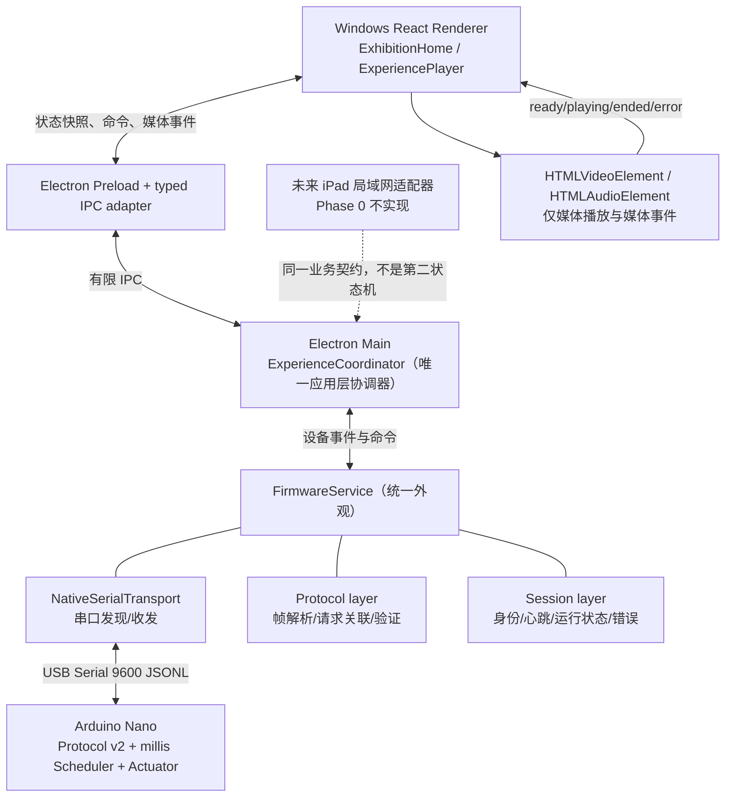

# Nature Touch — Phase 0 技术债清理与系统性重构实施方案

**版本：FINAL v1.0｜2026-11-02｜语言：中文**  
**状态：执行规格已确定；尚未修改项目源码、运行测试或验证真实硬件。**  
**用途：直接提供给 Codex，在新的 Git Branch 中逐阶段执行。**  
**原始依据：** `NATURE_TOUCH_SYSTEM_EXPLAINED_ZH_2026-11-02.md`（2026-11-02 只读代码审查）  
**下一阶段依据：** `Nature_Touch_Final_Exhibition_Plan_v3_ZH.md`（最终展览实装方案）  

> **一句话目标：在开发 iPad、5+15+8 秒新流程、新气动动作及正式发布之前，先把现有代码整理成职责明确、状态统一、可测试、可追溯、仍可运行的基础。**
>
> 这是一份**技术债重构执行文件**，不是新功能开发授权，也不是实机操作授权。不要为了追求“更先进的架构”引入额外复杂度。

---

## 0. 执行摘要：先做什么、不做什么

**本次要做**

1. 在**新 Branch** 中重构；旧 Branch 保存全部历史代码与证据。
2. 统一体验状态权属：**Electron Main 的原生 TypeScript `ExperienceCoordinator` 为唯一体验协调入口**。
3. 系统性整理 `FirmwareService`：Transport、Protocol、Session 各负其责，保留现有统一服务入口和 **Protocol v2**。
4. 系统性整理 `ExhibitionHome`、`ExperiencePlayer`：Home 负责 UI，Player 负责媒体；不让它们自行管理硬件运行真相。
5. 统一共享 TypeScript Command／Event／Snapshot 契约；重构**现有 Electron IPC**，为未来 iPad 留接口，但不实装 iPad 服务。
6. 整理统一 Arduino 固件的配置与 Protocol／Scheduler／Actuator 职责；**不重写 `millis()` 调度器**，不接入朋友尚未交付的新动作。
7. 清除已确认废弃的 Mock／Simulation ARM／Bench **正式运行入口**及旧诊断 UI，移除死代码；继续保留必要的纯软件测试替身与现有 AVR8js 测试能力。
8. 解决旧测试契约冲突、建立小规模核心自动回归、保留少量人工验证。
9. 建立 Git + Build Manifest + HEX SHA-256 + Hardware Config Version + Flash Record 的最小版本追溯。
10. 统一**本地持久化日志**，无日志 UI、无云端、无复杂监控平台。

**本次不做**

- 不开发 iPad 网页、Wi-Fi 服务、密码认证、远程状态推送。
- 不实现新的 0–5s Waiting、5–20s 有声 MP4、8s cooldown；这些属于后续 v3.0 方案。
- 不擅自修改 WIND／WAVE／BUBBLE 的真实动作节奏，不将旧表直接缩成 20 秒。
- 不引入 XState、Zustand、TanStack Store、Redux、tRPC、数据库、微服务或新测试框架。
- 不开发管理员 Dashboard、Reconnect／Recover UI、复杂自动故障恢复或自动重试系统。
- 不进行无人看护的带压实体测试，不将 `CONFIGURATION_VERIFIED=false` 直接改成 `true`，不以清理技术债为名绕开实体配置核对。
- 不因为某份文件有几百行就机械拆文件；职责清晰和可回归优先于代码行数。

**阶段完成定义（非常重要）**：Phase 0 的完成＝**重构完成、Windows 现有适用体验路径可运行、核心回归通过、未决实体风险被明确记录**；**不等于**“最终带压展览已验收”。

---

## 1. 已确认的全部工程决策（不得再反复询问）

| 决策 ID | 用户已确认的最终决定 | 执行含义 |
|---|---|---|
| TD-Q01 | B：系统性整理 Player／Home／FirmwareService | 允许按职责重新组织模块及接口，不做全仓重写 |
| TD-Q02 | B：删除不再使用的历史实现，依靠 Git 恢复 | **旧 Branch 保留历史**；新 Branch 不另建 Archive 目录，不保留无用生产路径 |
| TD-Q03 | 使用现有 React／TypeScript 管理状态 | Hooks、`useReducer`、显式类型；不引入状态管理新框架 |
| TD-Q05 | A：按 Transport／Protocol／Session 拆分 FirmwareService | 外部服务入口稳定，Protocol v2 与现有串行约束保持兼容 |
| TD-Q06 | A：Electron Main 原生 TypeScript `ExperienceCoordinator` | **唯一体验生命周期权威**；Home=UI，Player=媒体，FirmwareService=设备 |
| TD-Q07 | A：核心自动测试 + 少量手动验证 | 复用现有工具；每个阶段通过定向回归再继续 |
| TD-Q08 | A：统一硬件配置与权限结构 | 清理旧 ARM／Bench UI；不伪造 verified 结果，实体测试留到后续 |
| TD-Q09 | A：Shared TypeScript Contract | 统一 Command／Event／Snapshot；现阶段仅改 IPC，不开发网络 API |
| TD-Q10 | B：**不保留故障恢复 UI** | FAULT／意外 READY／断连后阻止新启动；工作人员检查后**手动重启 App** |
| TD-Q11 | A：Arduino 固件针对性重构 | 保留 `millis()`、Protocol v2，整理配置和 Protocol／Scheduler／Actuator 责任 |
| TD-Q12 | A：重构完成后 Windows 核心系统仍可运行 | **先迁移、测试，再删除旧路径**；不提前开放未经核实的真实输出 |
| TD-Q13 | A：Git + Build Manifest + HEX SHA-256 | 不给 IDENTIFY 增加哈希字段、不修改通信协议 |
| TD-Q14 | A：简单 Windows 本地持久化日志 | 关键事件、异常、版本可追溯；有限轮转；不加 UI／云端 |

说明：原来的问题编号未设 TD-Q04，因此按既有编号原样保留，不代表遗漏了一个未决问题。

---

## 2. 真实技术债清单（来自原审查报告）

以下证据指向**2026-11-02 审查快照**，不是对未来工作分支的实时断言。Codex 必须对当前文件重新定位；源码变动后行号可能变化。

| ID | 现状／证据 | 根本问题 | Phase 0 目标 | 边界 |
|---|---|---|---|---|
| TD-01 | Git HEAD `1ffce6c`（当时），许多重要文件未提交／未跟踪（原报告 §00.4、§10.9） | 源码、历史结果、二进制难以对应 | 建立干净且可回退的重构起点 | 不能丢失工作区改动 |
| TD-02 | `ExperiencePlayer.tsx` 当前循环静音 MP4 + 独立 MP3；旧单次测试与现有逻辑冲突（§00.3、§06、§10.3） | 不同阶段需求积累在同一组件 | 媒体生命周期与设备控制解耦，消除互斥的当前测试 | Phase 0 保持**当前仍在使用**的媒体行为，不提前实现新 15 秒流程 |
| TD-03 | `ExhibitionHome.tsx` 混合页面、选择、设备连接、START／STOP、Mock／ARM（§04、§11） | 展示组件承担控制与授权 | Home 只管理展示与页面局部状态 | 不把权限转移到 Renderer 来决定 |
| TD-04 | `arduino-firmware-service.ts` 约 860 行，承载身份、协议、请求、心跳、状态、错误（§11） | 职责集中、修改影响范围大 | 将纯协议／请求、Transport、Session 分清；保留服务外观 | 不重新发明 SerialPort、请求关联或队列 |
| TD-05 | 当前设备、页面、播放器各有生命周期（§02.3、§06.1、§10.8） | “本地到时”与设备 COMPLETED 可能争夺结束权 | Main 统一应用层生命周期、设备完成由 Arduino 确认 | UI 时间只能辅助显示，不得创造第二个设备完成事实 |
| TD-06 | 真实配置 544/2400 与 1200/1800 µs、verified 标志、旧台架授权不一致（§07.3、§10.5） | 配置没有唯一可信来源 | 建立硬件配置清单和集中准入条件 | **核对并记未知；不越权启用实体** |
| TD-07 | `500+300=800ms` 换向可能吞 WAVE／BUBBLE 短动作（§07.4、§10.6） | 驱动等待与时间表语义不一致 | 保留为下一阶段实体动作集成的明示限制 | 不在 Phase 0 猜测新参数或改动作表 |
| TD-08 | 最新实体 WIND 记录含异常 `READY`、截断 STATUS，根因未知（§10.2） | 硬件／固件运行异常尚未结案 | 保留诊断证据、提升日志可追溯性、形成后续实测阻塞项 | **不宣称 Phase 0 已修好**；不靠放大 384B 消息上限掩盖 |
| TD-09 | 测试找旧 Pause／Play、旧 cue 或相反 loop 规则（§06.5、§10.9） | 多套互相矛盾的验收契约 | 当前有效脚本只测试明确版本的行为 | 不能把旧 PASS 当新版 PASS |
| TD-10 | 模拟 ARM、Bench、诊断 API 和开发面板进入正式 UI（§03、§11） | 历史测试逻辑污染展览运行路径 | 清理生产入口、删死代码 | 离线自动测试替身可保留，不触发物理设备 |
| TD-11 | 媒体资源与发布目录分散（§10.10）、缺正式打包流程 | 后续可能漏文件且难确定版本 | 梳理静态资源和发布依赖清单 | **不在 Phase 0** 制作最终安装器或压缩媒体 |
| TD-12 | 日志、状态文案、构建与实体版本不统一（§10.5、§10.9、§11） | 现场问题难关联具体构建 | 持久日志、Build Manifest、烧录记录 | IDENTIFY 不当构建哈希使用 |

**本次重点解决 TD-01/02/03/04/05/06/09/10/12。** TD-07/08 的实体结案和 TD-11 最终安装器属于后续实装／验收依赖，Phase 0 必须明示、不得伪装已完成。

---

## 3. 目标架构与单一状态权属



### 3.1 唯一权属规则

| 事实／命令 | 唯一责任者 | 其它层可做什么 |
|---|---|---|
| 体验是否已接受、哪一个 operation 生效、是否允许新 START | `ExperienceCoordinator`（Electron Main） | Renderer 展示快照并提交用户意图；未来 iPad 也只提交意图 |
| Arduino 连接、身份、请求／ACK、设备 FAULT／COMPLETED | `FirmwareService` + 实际 Arduino 回报 | Coordinator 消费设备快照；不复制固件内部动作表 |
| 真实执行器动作和截止时间 | Arduino Scheduler / Actuator | Electron 不按视频计时器直接操控泵阀 |
| 媒体是否 ready／playing／buffering／ended／error | Renderer 的媒体元素与 Player | Main 可请求准备／播放并接收回执，但不假装 Main 实际播放了视频 |
| 卡片选择高亮、悬停、局部 dialog 布局 | `ExhibitionHome` / React 本地状态 | 不作为硬件运行依据 |
| 故障后重新投入使用 | **现场人员检查并重启 App** | 不创建访客或管理员 Recover UI；无自动重发旧 START |

**关键约束**：Main 不承担 MP4 解码；Renderer 不直接维护全局 RUNNING 的权威状态；FirmwareService 不负责 UI；Arduino 不需要了解 iPad。

### 3.2 合并状态时避免新的“单一巨型状态机”

- Main 的 `ExperienceSnapshot` 只描述**应用层聚合状态**，例如当前模式、operation ID、设备连接结果、运行阶段／不可用原因、最新版本号；具体字段以当前协议与需求审查后定。
- 设备的 `IDLE/RUNNING/STOPPING/COMPLETED/FAULT` 保持它自己的真实语义；媒体 `preparing/playing/buffering/error` 也保持独立语义。**统一控制权 ≠ 把三套不同来源的状态硬塞成一个布尔值。**
- 对外统一 `getSnapshot()` + `subscribe()`；事件只用于通知变更，客户端初始化时先取权威快照，并处理“订阅与取快照之间发生事件”的竞态（版本序号或重新读快照，选一种最小实现）。
- 对同一请求提供单次执行／in-flight 合并或拒绝；Main 是应用层防重入口；固件现有 `requestId/operationId` 规则继续保留。
- 状态中清楚区分 `requested` 与 `accepted/confirmed`，以及 `mediaEnded` 与 `deviceCompleted`。

### 3.3 Shared TypeScript Contract（应用层，不修改 Arduino v2）

建议放在当前项目已有共享类型位置，命名遵循实际目录结构，不强制新增单独 npm package。接口示意（**概念示例，不是必须照抄的最终字段**）：

```ts
// 属于 Windows 应用业务契约；不是 Arduino 的 JSON 串口帧。
type ExperienceMode = 'WIND' | 'WAVE' | 'BUBBLE';

type ExperienceCommand =
  | { type: 'SELECT'; mode: ExperienceMode }
  | { type: 'START'; mode: ExperienceMode };

type ExperienceSnapshot = {
  revision: number;
  phase: 'idle' | 'preparing' | 'running' | 'unavailable';
  selectedMode: ExperienceMode | null;
  operationId: string | null;
  deviceState: string; // 复用现有设备状态类型，勿长期保留 string
  reason?: string;
};

type ExperienceEvent =
  | { type: 'SNAPSHOT_CHANGED'; snapshot: ExperienceSnapshot }
  | { type: 'MEDIA_READY'; operationId: string }
  | { type: 'MEDIA_ERROR'; operationId: string; reason: string };
```

实现时必须：

- 复用 `experience-control-protocol.ts` 已定义的模式／设备状态类型，不创建两个不兼容的同名枚举。
- 保留前端名称 `WAVES/BUBBLES` → 协议模式 `WAVE/BUBBLE` 的清晰映射；不要直接改固件模式标识。
- `IPC` 使用现有 `contextBridge` 受限 API；不要打开 `nodeIntegration` 或把 Node API 裸露给 Renderer。
- 类型并不自动进行运行时校验；在 Main IPC 入站边界继续验证模式、命令和可用状态。
- **Phase 0 不新增 HTTP/WebSocket 端口**；未来局域网适配器复用同一个应用层契约，届时单独实现认证。
- 示例中 START/SELECT 的接口可按当前实际握手合并，避免在业务层创建两套重复命令；不得把此示例作为修改 Protocol v2 的要求。

---

## 4. Git 分支、版本记录与回退约定

### 4.1 启动前的前置操作（必须完成）

1. `git status --short`、`git branch --show-current`、`git log -1 --oneline`；记录当前工作区来源。
2. **检查所有未提交、未跟踪的关键源码／固件／资源。** 原报告指出 2026-11-02 时 HEAD 与工作区显著不一致。创建新 Branch 不能自动保存未提交文件。
3. 由实际 Git 仓库操作者**先在旧 Branch 将需要保留的当前工作副本 commit**，或以有记录的 stash／备份处理；确认其可恢复，再建立新重构 Branch。不要擅自覆盖、清空或把 untracked 文件删除。
4. 建议新 Branch 名 `refactor/phase0-technical-debt`（仅建议，实际名称按团队约定）。
5. **新 Branch 可以删除旧实现；旧 Branch 不变。** 无需新建 `archive/` 或复制一套源码到项目内。
6. 每个工作包单独 Commit；高风险修改分更小 Commit，能独立回退，不依赖整体 revert。

**注意**：如果当前没有 Git 操作授权，Codex 先提供拟执行的命令与差异，再等操作者执行；不得自称已经建立 Branch 或保存历史。

### 4.2 Build Manifest 最小字段

建议生成一个跟踪文件，如 `docs/build-manifest.json`，并由发布流程填入**实际取得**的值：

```json
{
  "app": {
    "gitCommit": "<实际提交号>",
    "buildType": "phase0-refactor",
    "builtAt": "<实际 ISO 时间>"
  },
  "firmware": {
    "hexSha256": null,
    "flashedAt": null,
    "flashVerified": false,
    "identityReported": null
  },
  "hardware": {
    "configVersion": "<已定义的配置编号>",
    "validationStatus": "unverified"
  }
}
```

- **这只是格式示例**。没有真实 HEX／烧录记录时，使用 `null`／`unverified`，不能填写历史哈希冒充当前已烧录固件。
- 构建可追溯到 Git Commit、对应参数版本与产物哈希；实体烧录由现场负责人记录时间和 verify 结果。
- IDENTIFY 继续只做现有身份识别；**不能因名字匹配便宣称构建 SHA 一致**。
- 每轮测试记录测试环境（纯软件／AVR8js／实体）、运行的代码版本、结果和已知限制；历史测试证据不覆盖不删除。

---

## 5. 按顺序执行的工作包（Codex 每次只做一个）

### P0-00｜Baseline & Dependency Map（先只读，随后建立 Git 起点）

**目标**：准确掌握现有代码和可运行路径，避免在不知道依赖时删除功能。

**读取／定位**：`AGENTS.md`（若存在）、`package.json`、`ExhibitionHome.tsx`、`ExperiencePlayer.tsx`、`main.ts`、`preload.ts`、`ipc.ts`、`arduino-firmware-service.ts`、`native-serial-transport.ts`、`experience-control-protocol.ts`、`nature_touch_unified.ino`、`actuator-driver.h`、`real-actuators.h`、现有测试与发布目录。所有路径以当前仓库查找结果为准，报告中的行号是历史定位提示。

**操作**：

- 输出当前调用链：`卡片 → 选择 → 媒体准备 → START → ACK/STATUS → 播放 → 停止/完成`。
- 输出状态写入点、订阅关系、所有 START/STOP 调用点、权限检查点、日志入口、文件大小及依赖图。
- 标记**仍被使用、可迁移、可以删除、来源未知**四类代码。
- 执行**不接触实机**的现有 typecheck／build／核心测试，记录已有失败和已知旧测试冲突；切勿先改测试使它“看起来全绿”。
- 完成 §4 的 Git 可恢复起点后，记录 Baseline Commit。

**DoD**：给出一张真实调用/状态图、一张删除候选清单、一个可复现的基线结果。不触发串口打开、烧录或实体气动。

### P0-01｜Shared Contract & Ownership（先定义责任，再迁移调用）

**目标**：整理应用层类型，不改变实际运行行为。

**主要文件**：当前共享协议类型、`ipc.ts`、`preload.ts`、Main IPC 注册部分，以及必要的新轻量类型文件。

**操作**：

- 复用现有模式、operation ID、设备状态类型；新增最少量应用层 Command／Snapshot／Event。
- 明确 Main 是状态的唯一发布者；Renderer 订阅只读快照。
- 将 IPC 的命令和事件名称集中管理，消除本层重复定义；保留 Main 侧验证。
- 设计 Renderer 获取初始 snapshot＋订阅更新的无竞态方式。
- 写纯 TypeScript 测试，验证合法命令、不可用状态拒绝、状态快照更新与重复请求规则。

**DoD**：类型检查通过；既有 IPC API 仍可运行；没有网络服务器；没有改 Arduino Protocol v2。

### P0-02｜FirmwareService Responsibility Split（高影响，渐进式）

**目标**：把当前约 860 行服务中的职责整理清楚，不推翻既有串口通信。

**职责目标**（不强制每项一个文件）：

- **Transport**：继续复用 `NativeSerialTransport` / SerialPort；负责打开、关闭、收发、字节／换行和错误事件。
- **Protocol**：帧解析、输入验证、消息分类、requestId／operationId 关联、ACK 处理和序列化规则；尽量纯函数，可脱离串口单测。
- **Session**：设备 IDENTIFY、连接生命周期、单一活动操作、心跳、STATUS／EVENT 消费、故障失效；不向 UI 输出 PWM 细节。
- **Facade**：继续提供稳定的 `FirmwareService` 统一入口，对 Main 只暴露必要命令和设备快照。

**不可改变的协议约束**：9600 baud、newline JSON、Nano 输入 160B、Host 返回行上限 384B、ID 长度最多 16 ASCII、现有 ACK 缓存／去重语义、当前 HOST_TIMEOUT 与心跳机制。**除非有明确证据并另行决定，否则 Phase 0 不改变这些常量或线协议格式。**

**回归用例**：连接/IDENTIFY、SELECT/START、重复 START、ACK 对应、STATUS、自然 COMPLETED、FAULT、HOST_TIMEOUT 事件、运行中 READY→DEVICE_RESET、USB 断开、超长／截断帧被拒绝、不重复发 START。

**DoD**：服务对上层的行为不变；测试可不接实物运行；原串行队列／请求关联机制仍有效；`READY` 异常仍按真实异常处理，而非自动恢复。

### P0-03｜Electron Main ExperienceCoordinator（唯一体验协调）

**目标**：将“选择／开始／停止／运行中状态／结束权属”从 Home/Player 的分散调用迁至 Main 的一个**原生 TypeScript** 模块。

**操作**：

1. 建立 Coordinator 的最小接口（例如 `getSnapshot` / `subscribe` / `select` / `start` / `handleMediaEvent`）；实际名称与现有调用适配。
2. 先**包装现有** `start-selected-experience.ts` / `stop-active-experience.ts` 以及 FirmwareService 路径，再逐步将启动协调职责移交到 Main；不要一口气删除 helper 后重新实现其去重语义。
3. 设备 RUNNING/COMPLETED/FAULT 的权威来自 FirmwareService/Arduino。`video.ended` 只能是媒体事件，不直接伪造设备完成。
4. 保持现有操作在 `READY`、断线、FAULT 时的拒绝行为；绝不因重新组织状态而再次下发同一 START。
5. 意外 READY：标记旧会话无效并停止接收新体验；**不自动重放/恢复**。
6. Coordinator 只“协调” Renderer 预加载/播放：它不能在 Main 内直接播放 HTML video。媒体晚到事件必须携带对应 operation/generation 的识别依据，不能污染新一轮。
7. **Phase 0 保持原有有效的体验时长与媒体行为**；最终 20 秒和休息门禁留给后续 v3.0。

**DoD**：Main 只有一个体验生命周期决策入口；Home/Player 不直接拥有另一套设备 RUNNING 真相；原现有链路正常；重复和迟到事件测试通过。

### P0-04｜ExhibitionHome / ExperiencePlayer Refactor（保持现有体验可用）

**ExhibitionHome 只负责**：三张卡片、悬停预览、局部选中 UI、导航及展示订阅快照；按钮动作通过受限 IPC 请求 Main，不直接串行控制 Arduino。

**ExperiencePlayer 只负责**：现有媒体预加载、播放、暂停/清理底层媒体、buffering、媒体错误和事件回报；不能自行决定设备是否 COMPLETED，也不直接发送 Firmware START。

**实施方法**：

- 以小型媒体 hook／reducer 收束 `preparing/playing/buffering/error` 及媒体异步清理；不需要创建一个新的通用状态机框架。
- **保留** `generation token`、取消等待、处理晚到 Promise、unmount 清理等有效语义；不得为了减少 refs 丢掉防止媒体“复活”的机制。
- 保留当前仍在用的 MP4 + MP3 播放能力**直到 Phase 1 的有声 MP4 已替代并通过测试**；此阶段可以删除死分支，但不要因为 TD-Q02 而删除仍被使用的媒体模块。
- 与 Coordinator 之间采用明确事件：media ready / playing / ended / error；错误不会发起新的硬件 START。
- 若原来的 `audio waiting → playing` 恢复缺口可在不改变产品时序的情况下修复，做一个针对性测试，避免视频仍 paused 却显示 playing。
- 保持当前正常页面仍可启动、打开体验并返回；Phase 0 不提前移除所有旧回退控件以至无法操作既有路径。最终“观众无停止／返回按钮”由 v3.0 实装阶段落实。

**DoD**：主页、三卡、悬停预览、现有媒体与主机命令能工作；切换/卸载/异步取消无重复 START；不再存在 Player→硬件直连的业务控制权。

### P0-05｜Arduino Config Consolidation & Legacy Path Removal

**目标**：整理固件的硬件参数来源、编译入口与正式运行准入，不在软件重构时擅改物理行为。

**主要位置**：`firmware/unified/.../nature_touch_unified.ino`（以实际路径为准）、`experience-timelines.h`、`actuator-driver.h`、`real-actuators.h`、Main 的旧 profile、`ArduinoConnection.tsx` 及关联 IPC。

**操作**：

- 对照旧独立 `.ino`、当前统一固件、历史 locked 和 open-air bench 发布记录，生成**硬件配置对照表**：D5／D6／D7 作用、OFF/ON PWM、STOP 阀位、500/300ms 换向条件、已知实体观察证据及未知项。
- 将当前选择使用的配置以一个**权威配置定义**（头文件/配置模块或小型清单）表达；保证其他代码读取它，不复制多份相反数字。
- 保留 `millis()` 绝对截止调度、PROGMEM 动作表、停止/互斥驱动、HOST_TIMEOUT 与已有 Protocol v2；可以整理函数边界，不改变消息与时序。
- **不擅自确定** D6 544/2400 或 1200/1800 哪个就是最终正确；标明当前工作副本与历史实体证据之间的差异。
- 删除正式 UI 中的 Simulation ARM、Open-air Bench、旧测试 STOP/RECOVER 控件与不再使用的诊断入口；保留必要的后台内部 STOP/FAULT 行为。
- 如旧 `--open-air-bench` 只为过时运行路径服务，清理生产启动入口；如仍存在独立测试必需的工具，限制在**测试工程**而非正式运行路径，并记录保留原因。**不要用删除门禁换取未经验证的带压启用。**
- 保留离线测试夹具或 AVR8js，不让它们进入打包后的观众 UI；不需要生产运行时 Mock 开关。
- 故障后不提供恢复 UI：Windows 展示不可用（或停用卡片），现场检查并重启；重启连接仍需既有身份和有效配置检查。

**DoD**：正式运行路径没有日常 ARM／Bench 按钮；配置只有一个权威来源，未验证项如实标记；协议及固件调度测试通过；**实际带压通过与否仍 UNKNOWN**。

### P0-06｜Tests, Local Logs, Build Manifest, Documentation

**目标**：把重构结果变成可持续维护的项目，而不是只靠“Codex 说改好了”。

**测试整理**

- 盘点 `package.json` 测试脚本，保留真正有价值的 Node／TypeScript／AVR8js 测试。
- 当前测试与当前行为不一致的（旧 Pause／Play、单次 loop=false、延迟 cue 等），**按 Phase 0 当前运行契约更新或移出默认测试入口**；不要一边要求 24/25/27.42 秒旧体验、一边要求 15 秒最终体验作为同版本强制验收。
- 历史测试证据留在旧 Branch／Git 历史；新 Branch 不复制一整套 archive 文件。
- 最小测试集合：合同／类型、IPC 边界、FirmwareService 协议、Coordinator 状态转换、Player 异步取消、Home 展示调用、固件 AVR8js 主要路径。
- **没有必要新装 Playwright/Vitest。** 现有工具无法覆盖某个关键行为时，优先加轻量测试替身。

**Windows 本地日志（TD-Q14）**

- 优先复用已有日志／JSONL 路径；如没有可用持久化，使用 Electron `app.getPath('userData')` 下专用 `logs/`，不能写入只读 app.asar。
- 建议单条记录字段：`timestamp`, `level`, `event`, `appCommit`, `hardwareConfigVersion`, `operationId`, `deviceIdentity`, `phase`, `reason`；字段未知时省略，不猜测。
- 至少记录：应用启动/退出、串口打开/关闭、IDENTIFY 结果、SELECT、START、ACK、COMPLETED、FAULT、运行中意外 READY/DEVICE_RESET、断连、解析错误、媒体错误、现场重新启动。
- 结构化简短 JSONL，有限文件轮转：例如**单文件 2 MB、保留最多 5 份**（可配置的工程默认值，不是必须恰好该数），写入失败不得阻塞体验调度。
- 不记录密码、会话令牌、完整敏感输入，也不在普通日志打印不必要的原始大量串口数据。异常定位时可在授权的调试构建单独采样原始 RX/TX。
- 不增加日志界面、云上传、远程监控或新日志服务进程；如现有机制足够，可直接增强而非再加依赖。

**Build Manifest 与文档**

- 根据 §4 记录 Git commit、固件 HEX 哈希（如果真实产物存在）、硬件配置版本、烧录事实与测试环境。
- 更新 README / `AGENTS.md`（如果已有）中的当前职责图、常用命令、端口及真实设备使用界限；避免把旧 PREPARE/CANCEL 文档当正式已实现功能。
- 建立简单 `PHASE0_HANDOFF.md`，列出已解决的技术债、Phase 1 尚需的动作代码／媒体及实体检查。

**DoD**：所有默认测试指向一致的 Phase 0 行为；日志可在本地找到且轮转有限；构建与固件记录不会虚构验证；开发者可从文件看懂入口。

### P0-07｜Final Regression & Handoff（Phase 0 关口）

**必须实证完成以下项目**（不是全部测试都必须接实体）：

- [ ] `typecheck` 通过、Windows build 通过，或明确记录环境导致的外部限制。
- [ ] Windows Electron App 启动并显示主页、三卡、媒体入口。
- [ ] 现有适用的体验路径仍可使用（对应同一构建契约）。
- [ ] 无设备时 UI 不崩溃；不可用时不能发 START。
- [ ] 受控测试环境中同一轮 START 只发一次；旧回调不触发下一轮 START。
- [ ] 正常 ACK／STATUS／COMPLETED、错误/超长帧、FAULT、DEVICE_RESET、断连的核心服务测试通过。
- [ ] Renderer 视频结束不会冒充 Arduino 设备完成。
- [ ] Main 的 Coordinator 是唯一业务协调者；Home/Player 不再绕开它直连设备 START。
- [ ] IPC 共享契约的快照和订阅行为通过测试；未来 iPad API 尚未实现且在交接中注明。
- [ ] `millis()` 固件调度与现有主要时间表回归通过，未接入新版三模式表。
- [ ] 真实硬件配置差异有清单，`verified=false` 未被伪造消除。
- [ ] 旧 ARM/Bench UI 与无用生产诊断入口已经清理；测试工具不出现在观众包中。
- [ ] Windows 本地日志可落盘、能限制文件数量，能够定位 operation 和构建。
- [ ] Git 基线 Commit、逐工作包 Commit、Build Manifest 与回退方式明确。
- [ ] 不存在与现版本矛盾却仍在默认测试中强制通过的旧断言。
- [ ] Codex 给出每个已修改模块的“之前／之后／保留／删除”清单及未解决事项。

**关于真实硬件**：Phase 0 **不要求或冒充**带压实测通过。`READY/STATUS` 异常、D6/D7 参数映射、实际复位默认 OFF、换向短动作、最终 20 秒动作与装置连续运行，均以**已知问题／后续验收依赖**移交 v3.0。

---

## 6. 最小测试矩阵：哪些测试、为什么

| 测试类别 | 最少验收场景 | 是否需要实体硬件 |
|---|---|---|
| Pure TypeScript | 模式与共享类型、命令合法性、快照 revision、无效状态拒绝 | 否 |
| FirmwareService 单测 | IDENTIFY、ACK 关联、STATUS、重复 START、心跳、FAULT、READY、断连、超长/截断行 | 否（使用离线传输替身） |
| Coordinator 单测 | 一轮只启动一次、START 失败保持不可用、设备 COMPLETED 权属、晚到媒体事件不污染新轮 | 否 |
| React/Player 定向测试 | 资源就绪／取消／buffering 恢复、组件卸载、无隐式重新 START | 否 |
| AVR8js／固件离线测试 | 现有协议、固定时间表、StopAll、HOST_TIMEOUT、内存约束的已覆盖范围 | 否 |
| Windows 手动 Smoke | 双击运行、首页显示、正常媒体、基本设备状态 UI、退出与重开 | 可先不接实体；接入真实设备须现场安排 |
| 后续真实完整展览测试 | 三种新版动作、确认 OFF、复位/READY、媒体/投影/iPad、连续运行 | **是，Phase 1–4** |

不要将离线 Mock、AVR8js 或编译 PASS 解释为真实气压、供电或者泵阀已通过。

---

## 7. 故障处理与安全范围（刻意保持简单）

Nature Touch 是约三天、每天约六小时、**有人值守**的展示项目；**Phase 0 不开发复杂安全平台**。正常运行应自动，不增加日常人工 ARM、后台登录或层层确认。

仅保留四条底线：

1. Arduino 现有 `STOP/FAULT/HOST_TIMEOUT`、非阻塞动作截止、泵阀互斥和 `stopAll` 不因 Refactor 丢失。
2. 一旦运行中出现意外 `READY`、FAULT 或断连，**拒绝新的 START**，不得自动把旧操作重新开始；日志说明“物理输出状态未被软件确认”的情况。
3. 现场人员负责停止开放体验、检查设备与供电、必要时人工断能；确认后**重启 App**。**不开发 Reconnect/Recover UI 或自动故障修复。**
4. 真实驱动的默认 OFF、D5/D6/D7 参数和正式有压运行条件仍需后续实体核对；Phase 0 不得通过强行移除校验假装完成。已有 RESET 期间 D7 继续运行的历史观察应保留为后续针对性验收项。

**不扩展**：工业级故障注入平台、温度/电流传感器系统、远程自动重启、每天需人工解除的多级准入。**也不把“有人值守”解释为可以让软件在身份或参数未确认时驱动实物。**

---

## 8. 删除策略：删干净，但先证明已不使用

### 可以考虑删除（通过引用搜索与测试后）

- 正式展览 UI 的 Simulation ARM、Mock 模式选择器、Bench 授权面板、手动测试 STOP／RECOVER 按钮。
- 不再使用的旧诊断 IPC／文案、无人引用的媒体分支、与当前契约冲突的废弃断言。
- 已被 Coordinator 取代的旧 Home→Firmware 直接调用逻辑。
- 迁移后冗余的原始接口、重复类型与重复权限状态变量。

### 不应一概删除

- `NativeSerialTransport`、FirmwareService 外观、ACK／队列／心跳／故障路径。
- 固件 `stopAll`、超时、互斥与 `millis()` 调度。
- Player 中防异步晚到的 token／取消逻辑。
- Phase 0 当前**仍实际使用**的媒体文件／MP3 同步能力；必须由后续新有声 MP4 替代并验收后才删除。
- 离线自动测试必需的 fake/mock transport、AVR8js 仿真脚本。**删除生产 Mock 模式不等于删除全部测试替身。**
- Git 旧 Branch 中的原始 `.ino`、历史 HEX 与测试证据。

如果一项“看似旧代码”仍被用于保证当前 Windows 核心可运行，先迁移与替代，绝对不能直接删除并声称 Phase 0 完成。

---

## 9. Phase 0 结束以后，怎样进入最终 v3.0 实装

后续工作以 `Nature_Touch_Final_Exhibition_Plan_v3_ZH.md` 为目标，不在本次提前开发：

| 后续阶段 | Phase 0 交付的可复用基础 | 后续需要完成 |
|---|---|---|
| Final-01 设备与正式构建 | 集中配置 + 统一 Coordinator + Version Manifest | 真正核准硬件参数、必要实体检查、简化后的自动连接 |
| Final-02 媒体 | 已解耦的 Player 与媒体事件 | 5 秒主题 Waiting、15 秒有声 MP4、取消旧 MP3、验证音轨和自动播放 |
| Final-03 iPad | Shared Contract + Main 唯一状态权属 | 局域网 API、密码认证、学校 Wi-Fi、远端重连状态同步 |
| Final-04 体验周期 | Coordinator 与 Arduino 完成权属 | 5 秒初始充气 + 15 秒动作 + 至少 8 秒休息；设备 COMPLETED 后开始可信休息门禁 |
| Final-05 三种气动动作 | 配置清单 + 保留的 `millis()` Scheduler | 朋友交付新版三模式表后整合，核对 800ms 换向对短动作影响 |
| Final-06 正式发布 | Git/HEX/Log 追溯、现有 build 可运行 | 安装器/本地素材、投影与音响、3 天 × 约 6 小时的现场运营验收 |

**不得跨阶段宣称完成**：Phase 0 结束时不应说“iPad 已连接”“20 秒动作完成”“正式实体验收通过”或“异常 READY 已修复”，除非另外真的实施并给出对应证据。

---

## 10. Codex 执行协议（可以直接把本文件作为主任务）

**给 Codex 的工作指令：**

> 你现在执行 Nature Touch **Phase 0 Technical Debt Remediation**，不是最终展览新功能开发。先阅读本 MD、2026-11-02 的完整审查报告、当前仓库与 `AGENTS.md`（如果存在），以当前真实代码为准，不能机械依赖审查时的行号。
>
> 逐一执行 **P0-00 → P0-01 → P0-02 → P0-03 → P0-04 → P0-05 → P0-06 → P0-07**。每次只完成一个工作包、运行对应的无硬件回归，再报告结果；不要一次修改所有模块。
>
> 旧 Branch 保存历史，新 Branch 删除已确认废弃的实现。重构期间 Windows 当前适用体验必须保持可运行。**Electron Main 的 ExperienceCoordinator 是唯一体验协调权威**；Home 只展示，Player 只处理媒体，FirmwareService 只管理设备。应用层共享 TypeScript Contract，不改变 Protocol v2；不引入新状态管理框架。
>
> Phase 0 不实现 iPad、5+15+8、新气动表、最终安装器，也不擅自打开实体 COM／上传固件／启动泵。清理 ARM/Bench 旧入口不等于放行未经核对的真实硬件。
>
> 故障后只允许工作人员检查并重启 App，不做恢复 UI；保留简明本地持久日志与 Git/HEX/配置追溯。
>
> 如果发现本 MD 与当前真实源码不一致，先提供**事实、影响、最小兼容改法**，不要私自扩展需求或把未知写成已通过。遇到必须实体测试的条件，停止于软件边界并列为后续依赖。

### 每个工作包必须报告的格式

```text
Work Package: P0-XX
Status: PASS / PARTIAL / BLOCKED
Baseline Commit:
Changed Files:
Removed Legacy Code:
Architecture Change (Before → After):
Tests Run + Actual Results:
Behavior Preserved:
Known Limitations / Hardware-Dependent Items:
Next Allowed Work Package:
```

### 遇到阻塞的最小决策原则

1. **优先修复已证实的技术债**；不要为理论极端情况增加系统复杂度。
2. 不明确的源代码语义先标 `UNKNOWN` 并定位证据，不猜测实体配置。
3. 可以减少重复的上层状态和 UI 门禁，**不能删除真正跨越进程／硬件信任边界的必要检查**。
4. 已有有效的库和模块继续用，除非有实证显示替换能减少维护成本。
5. 重构前后行为不同，必须明确指出变化属于 bug fix、刻意删除、还是误回归；不准静默改变时序。

---

## 11. 最终交付物与签收标准

**交付物**

- [ ] 新 Branch + 基线 Commit + 分阶段 Commits（旧 Branch 保持历史）
- [ ] 当前调用链与模块职责图
- [ ] Electron Main `ExperienceCoordinator` 及最小公开接口
- [ ] Shared TypeScript Experience Contract 与 typed IPC
- [ ] 按 Transport／Protocol／Session 分离的 FirmwareService（保留统一外观）
- [ ] 精简后的 ExhibitionHome 与 ExperiencePlayer（当前适用流程仍可运行）
- [ ] Arduino 配置来源及 Protocol／Scheduler／Actuator 职责整理
- [ ] 清除过时生产 ARM／Bench／Mock／诊断 UI 和死代码
- [ ] 更新的核心自动回归测试与 Windows 手动 Smoke 结果
- [ ] Windows 本地有限轮转日志
- [ ] Build Manifest、Hardware Config Version、HEX/烧录记录（真实数据或明确 UNKNOWN）
- [ ] `PHASE0_HANDOFF.md`：已解决问题、未决实体问题及 v3.0 依赖清单

**最终通过定义**：以上交付物具备、回归结果可复现、当前 Windows 核心路径不被破坏；**实机 READY 异常与有压准入仍可列为后续明确阻塞，不要求在本次软件重构中虚构结案。**

---

## 附录 A｜报告与本文件的对应关系

| 原报告章节 | 在 Phase 0 的用途 |
|---|---|
| §00、§01 | 版本演进、Git 与历史验证范围；防止混淆当前代码和旧结果 |
| §02、§03、§04 | 原始跨进程架构与 START／STOP 调用链 |
| §05、§07 | 三模式时间表、Protocol v2、Nano 资源、真实 PWM 参数差异 |
| §06 | 媒体状态、纠偏、取消、generation token、旧测试对照 |
| §09、§10 | 已证实 Bug、条件性缺口及尚未结案的问题 |
| §11 | 重构优先于换新库，保留成熟依赖 |
| §12、§13 | 开发先后、实际源码导航、验收证据检查方法 |

## 附录 B｜绝对不要混淆的三个版本

1. **审查快照**：`NATURE_TOUCH_SYSTEM_EXPLAINED_ZH_2026-11-02.md` 记录的是当时读取到的工作区；不是最新硬件确认书。
2. **本 Phase 0 文件**：用于**先还技术债**；不改变最终展览产品需求。
3. **最终展览 v3.0 文件**：用于 Phase 0 之后的**新功能实装**；其 5+15+8 秒规则不应被误当成 Phase 0 当前已有行为。

**核心原则：先建立可维护、可测试的单一控制架构，再接入最终展览体验；简化软件复杂度，但不编造真实硬件已验证的结论。**
