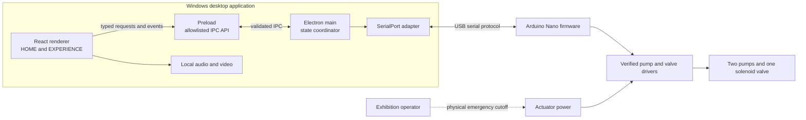

# Nature Touch Architecture

## Status and evidence

This is a proposed architecture, not an implementation specification for unverified hardware.

**Confirmed from the project brief:** the target is a Windows exhibition installation; the intended modes are WIND, WAVE, and BUBBLE; the listed hardware is an Arduino Nano, two DC air pumps, one solenoid valve, and USB; three calibrated Arduino sketches, three MP3 files, a Chinese requirements document, and hardware photos are said to exist; the existing movement timing must be preserved. No files were present in the inspected workspace, so none of those resources, their contents, or their pin mappings have been verified.

**Proposed:** React and TypeScript in Electron; Node.js SerialPort in Electron's main process; a small newline-delimited serial protocol; local media; and no cloud service or database. Details below are subject to review against the actual sketches and hardware.

## Goals and boundaries

- Keep the calibrated movement timing in the Arduino sketches. Integrate their patterns with the smallest possible changes; do not re-time them to suit the UI.
- Let Arduino serial and hardware checks proceed before, and independently of, the frontend.
- Keep physical outputs under firmware control. The desktop sends mode and lifecycle requests; it does not directly toggle pump or valve pins.
- Make the renderer unprivileged: it uses a narrow preload API and cannot access Node.js, filesystem, or serial APIs directly.
- Treat disconnects, resets, malformed messages, and timeouts as faults that stop an experience and require a deliberate recovery path.
- Do not represent software shutdown as a physical safety cutoff.

Out of scope: cloud services, a database, remote control, automatic firmware updates, pressure sensing not present in the confirmed hardware list, and implementation of the UI or pump-control firmware in this architecture step.

## System diagram



The physical cutoff is a required safety provision to verify or add, not a confirmed existing component. It should interrupt actuator power independently of the desktop and Arduino.

## Module responsibilities

| Module | Responsibility | Must not do |
| --- | --- | --- |
| React renderer | HOME/EXPERIENCE screens, three-mode selection, media presentation, device/status display, operator-visible errors, and start/cancel requests | Open serial ports, access Node APIs, or directly command actuator pins |
| Preload | Expose a small typed API such as `getDeviceState`, `connect`, `prepare(mode)`, `start(requestId)`, `cancel(requestId)`, and `subscribe(listener)`; validate argument shapes and remove event listeners on unsubscribe | Expose generic IPC, `require`, filesystem, or unrestricted channel names |
| Electron main | Own connection lifecycle and authoritative device state; validate renderer requests; correlate request IDs; enforce timeouts and legal transitions; send sanitized state/events to the renderer | Assume a renderer's displayed state is authoritative or treat a lost serial link as a successful stop |
| SerialPort adapter | Enumerate/select the configured device, open/close serial, parse bounded newline frames, serialize writes, and report transport errors | Contain mode/UI policy or infer safe electrical output values |
| Arduino firmware | Own output initialization, calibrated patterns, mode execution, timing, cancellation, watchdog/communication-loss behavior, and protocol acknowledgements | Depend on the Windows UI for a safe output state or block pattern timing on serial input |
| Media controller (renderer) | Load local audio/video, start/stop playback in response to acknowledged device events, and handle missing/failed media | Claim exact physical/audio synchronization without measured latency and an agreed synchronization test |
| Mock device adapter | Implement the same host-side device contract for UI and protocol-flow testing without hardware | Be treated as evidence of electrical safety or real serial timing |

Use TypeScript interfaces at the renderer/preload boundary and a small host-side device interface so real and mock adapters can be substituted in tests. Avoid adding a separate service process, plugin system, database, or general event bus unless later requirements justify one.

## Application screens and state

HOME offers WIND, WAVE, and BUBBLE selection plus connection/readiness status. EXPERIENCE presents the selected mode, the current playback/interaction state, and a clear cancel/return action. Disable start unless the device is connected, firmware identity/protocol is accepted, and the device reports ready. Show actionable errors and a recovery action; do not hide faults behind automatic retries.

The Electron main process is authoritative for device state. The renderer owns transient presentation and media element state, but derives hardware readiness from main-process events. Suggested device states:

`disconnected -> connecting -> connected_not_ready -> ready -> preparing -> prepared -> running -> stopping -> ready`

Any transport error, invalid protocol response, or unexpected device reset transitions to `faulted` (and closes or invalidates the session). A deliberate reconnect starts at `connecting`; it does not resume a prior run. Firmware states should map to these host states without pretending that software can verify physical pressure or actuator safety.

Mode lifecycle: select a mode while idle; `PREPARE` selects/initializes that mode and places firmware in a defined prefill/ready state; Arduino replies `READY` only after it has completed the required prefill and can start; host sends `START`; Arduino emits `STARTED` when the pattern actually begins; renderer starts the associated media on that event. On cancel, host sends `CANCEL`; firmware interrupts at its next safe control point, applies the verified safe-output routine, then acknowledges `STOPPED`. The meaning and actuator behavior of reset and prefill must be reconciled with the existing sketches before implementation.

## Data flow and synchronization

1. Renderer asks preload to connect or prepare a mode. Preload forwards only named, validated calls to main.
2. Main checks legal state transitions and request IDs, then asks the serial adapter to send a protocol command.
3. Firmware validates the command and current state, performs the state transition, and returns a correlated acknowledgement/event.
4. Main validates the response, updates its state, and publishes a sanitized event. Renderer updates status and controls local media.
5. At start, host sends `START` only after firmware has reported `READY`; media begins on the correlated `STARTED` event. At stop/fault, media stops immediately on the host-side event while firmware independently attempts its verified safe state.

Starting media on `STARTED` makes the device's actual start event the synchronization reference, but USB, OS scheduling, and media decoder latency still create offset and jitter. Measure these on the exhibition machine. If the result is insufficient, add a measured, explicit scheduling mechanism (for example a firmware start delay agreed in advance); do not add speculative clock synchronization or alter calibrated movement timing.

## Serial communication design

Proposed first protocol: UTF-8/ASCII, one JSON object per line, terminated by `\n`, at a baud rate agreed with the existing sketches. Keep frames small and bounded for Nano RAM. Use a protocol version and firmware identity in `HELLO`/`STATUS`; reject unsupported versions rather than guessing. This is a proposal to validate during USB serial bring-up, not a known feature of the existing firmware.

Example message shapes (illustrative):

```json
{"type":"HELLO","protocol":1,"requestId":"c7"}
{"type":"ACK","command":"HELLO","requestId":"c7","state":"IDLE","firmware":"nature-touch"}
{"type":"PREPARE","mode":"WIND","requestId":"c8"}
{"type":"EVENT","name":"READY","requestId":"c8","mode":"WIND"}
{"type":"START","requestId":"c9"}
{"type":"EVENT","name":"STARTED","requestId":"c9","mode":"WIND"}
{"type":"CANCEL","requestId":"c9"}
{"type":"EVENT","name":"STOPPED","requestId":"c9"}
```

Minimum command/event set: `HELLO`, `STATUS`, `PREPARE(mode)`, `START`, and `CANCEL`; responses include correlated `ACK`, `READY`, `STARTED`, `STOPPED`, and structured `ERROR`. `requestId` is generated by the host for each operation and echoed for its response. Firmware-originated faults include a stable error code and current state. The exact encoding can be simplified if RAM or legacy sketch constraints require it; message meanings and correlation must remain explicit.

Protocol rules:

- One outstanding state-changing request at a time. A new mode cannot be prepared while running; cancel before switching.
- Set finite, operation-specific host timeouts. A timeout invalidates the operation, marks the device faulted/not-ready, stops local media, and triggers a best-effort cancel only if the port remains usable. Do not assume the cancel reached the device.
- Ignore and log stale responses with unknown request IDs; reject malformed, oversized, or unsupported messages. Bound the input line buffer and recover at the next newline.
- On serial close, unplug, port error, or unexpected boot/HELLO, stop media, clear readiness, fail pending requests, and require an explicit reconnect and fresh handshake. Never auto-resume.
- On reconnect, enumerate ports and use an operator-selected or explicitly configured port with identity checks. Do not silently connect to the first arbitrary serial device.
- Firmware should have a communication-loss policy based on a watchdog/heartbeat timeout if the running sequence can otherwise continue unsafely after USB loss. Its timeout and safe outputs must be validated on the bench. A completed finite pattern may instead reach a verified safe end state. USB-loss behavior does not replace physical cutoff.

## Arduino integration strategy

First inspect and archive the three supplied sketches when available. Identify shared and mode-specific output writes, all timing constants, blocking delays, serial usage, initialization/reset behavior, and any duplicate definitions. Preserve timing values and sequence order. Prefer a small dispatcher that selects one existing pattern implementation; avoid rewriting calibrated motion merely to fit an abstraction. If the sketches cannot be compiled together, keep their pattern logic in separate compilation units or use a single firmware build with mutually exclusive mode functions, according to the actual code and Nano memory limits.

For non-blocking control, express pattern progress as states and deadlines based on `millis()`, with serial parsing serviced on every loop iteration. Avoid long `delay()` calls in paths that must observe `CANCEL` or a communications watchdog. The requirement is responsiveness without changing the calibrated transition times; measure and compare output timing before/after integration. If the legacy sequence uses blocking timing, first document and baseline it, then refactor only with waveform/timing equivalence tests.

Define explicit firmware states such as `BOOT_SAFE`, `IDLE`, `PREFILL`, `READY`, `RUNNING`, `STOPPING`, and `FAULT`. Establish electrical output states only after driver polarity and power-up behavior are verified. `CANCEL`, reset, watchdog expiry, and internal error route to a single safe-shutdown routine. Do not use `Servo.write()` as a pump/valve OFF operation; these actuators are not confirmed servos, and no numeric servo value is established as safe. Firmware fault reporting must not delay the immediate local safe-output action.

## Electron security and lifecycle

Use `contextIsolation: true`, `nodeIntegration: false`, and a restrictive Content Security Policy. Preload exposes only the typed operations required by the UI. Validate every IPC payload in main (including mode enum and request ID length); renderer input is untrusted. Keep serial ownership and port handles in main. Load packaged local assets through a controlled asset path; do not enable arbitrary remote content or navigation. Ensure window close requests a best-effort stop and port close, while documenting that process shutdown cannot guarantee electrical shutdown.

## Hardware safety and unresolved behavior

Known from the brief and subsequent physical inspection: Arduino Nano (exact variant unconfirmed), USB, two SC-3704PM-A DC 6 V micro air pumps, one solenoid air valve; D5 is associated with the valve and D6/D7 with the pumps. Each channel uses the same type of transparent three-wire-in/two-wire-out control module. This channel association does not verify board-to-module electrical continuity, module trigger behavior, or actuator state. Unknown: Nano variant and bootloader; module model/circuit/thresholds/rating/polarity/fail-safe; load-side topology/current; valve normal state; supply capability; pump/valve ratings; tubing and manifold; pressure instrumentation/regulator/relief/check valves; grounding/isolation; enclosure; and an emergency power cutoff. No safe pin level or actuator behavior can be inferred from the component names or Servo values.

Before connecting or energizing actuators:

- Trace and document each Nano pin to its driver input and each driver to its load; confirm logic polarity, boot/reset behavior, current rating, flyback protection, supply, and common-ground/isolation requirements from component documentation and measurements.
- Establish safe outputs with actuators disconnected, then verify driver output states with suitable instruments. Do not infer OFF from a software value or use `Servo.write()` for this hardware.
- Provide an accessible, independent physical cutoff that removes actuator power, and verify it under test. Establish pressure limits and suitable regulator/relief protection, rated tubing/fittings, and a controlled depressurization method before tactile use.
- Make startup and reconnect conservative: actuator power remains physically disabled until inspection and explicit operator enable; firmware initializes verified safe outputs before accepting commands; reconnect performs handshake/status only and never restarts a mode.
- Validate stop, USB unplug, Arduino reset, host crash, and power-cycle outcomes with a safe test fixture before human contact. Have an operator-supervised procedure and keep people clear during initial actuator tests.

The architecture cannot certify a safe shutdown until the driver, plumbing, pressure limits, and independent cutoff are identified and physically tested. Unknowns are blockers for live tactile operation, not values to fill in by assumption.

## Proposed project structure

This is a suggested layout only; do not create application files until the architecture is reviewed and the existing resource files are inspected.

```text
nature-touch/
  docs/
    architecture.md
    development-plan.md
    hardware/
      wiring-and-pin-map.md
      safety-checklist.md
  firmware/
    nature-touch/
      nature-touch.ino
      patterns/                 # integrated pattern code, preserving calibrated timing
  desktop/
    package.json
    electron/
      main.ts                   # lifecycle, state coordinator, IPC handlers
      preload.ts                # allowlisted API
      serial/
        protocol.ts             # frame types/parser
        serial-device.ts        # real SerialPort adapter
        mock-device.ts          # software-test adapter
    renderer/
      src/
        app/
        screens/                # HOME and EXPERIENCE
        media/                  # local media controller
        device/                 # typed preload client and UI state
  assets/
    audio/                      # supplied MP3s, after inventory
    video/                      # local exhibition video, if supplied
  test/
    protocol/
    device/
```

The original `.ino` files should first be copied into a clearly labeled, unmodified reference location under `firmware/original/` (or maintained outside the repository if their ownership/distribution requires it). Do not overwrite originals during integration. Do not add separate packages for each UI screen or create a general plugin architecture without a concrete need.