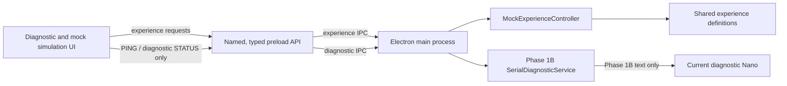

# Phase 2A: Unified Experience Control and Mock Simulation

## Scope and evidence

Phase 2A defines reusable source-derived experience data, a software-only controller, and a proposed future device protocol. It does not send experience commands over serial, implement Arduino experience firmware, or drive physical outputs. The Phase 1B text protocol remains separate and unchanged.

The original sketches are unchanged. Timelines below are derived from their ordered `delay()` calls and marker positions. Pin-to-device associations reflect user physical inspection; `Servo.write()` values remain source signal values, not verified electrical or actuator states.

## Unified architecture



The mock controller and experience definitions have no SerialPort imports. Experience IPC handlers call only the mock controller. Existing serial handlers accept only Phase 1B `PING` and `STATUS`; do not send protocol version 2 JSON to the current diagnostic Arduino firmware. The firmware accepts neither experience commands nor the proposed control message schema.

Code locations:

- `desktop/shared/experience-definitions.ts`: source-derived action timelines and original signal values.
- `desktop/shared/experience-control-protocol.ts`: typed proposal for a later firmware protocol.
- `desktop/experience/mock-experience-controller.ts`: isolated simulation state machine.
- `desktop/experience/experience-clock.ts`: injectable clock boundary.
- `desktop/electron/main.ts` and `desktop/electron/preload.ts`: named mock IPC methods, separate from diagnostic serial methods.
- `test/experience-definitions.test.ts` and `test/mock-experience-controller.test.ts`: timing and state-machine tests.

## Hardware associations

| Arduino channel | Physically confirmed association | Source sketch signal in INFLATE | Source sketch signal in DEFLATE |
| --- | --- | ---: | ---: |
| D5 | Solenoid air valve | 180 | 0 |
| D6 | SC-3704PM-A DC 6 V micro air pump | 180 | 0 |
| D7 | SC-3704PM-A DC 6 V micro air pump | 0 | 180 |

Each uses the same class of transparent module with three-wire input and two-wire output. The exact module model, trigger pulse thresholds/frequency, electrical ratings, polarity, isolation, and reset/no-signal behavior are not verified. The table records association and sketch values only. It does not label any value ON, OFF, safe, open, closed, inflate, or deflate electrically.

## Original experience definitions

The shared definitions encode an ordered list of `MARKER` and `ACTION` events at offsets from the start of one sketch loop. ACTION stores duration and all three source `Servo.write()` values. A future Arduino implementation may consume these as reference data, but the firmware must own physical scheduling and honor measured safety behavior. Desktop timer callbacks are only for simulation and must never replace calibrated Arduino timing.

### WIND

Source: `卒研music/wind/sketch_oct21a/sketch_oct21a.ino`. Cycle duration: 24,000 ms.

| Offset (ms) | Event | Duration (ms) | D5 / D6 / D7 source values |
| ---: | --- | ---: | --- |
| 0 | `INITIAL FILL`; INFLATE | 5,000 | 180 / 180 / 0 |
| 5,000 | `PLAY WIND AUDIO NOW` | marker | n/a |
| 5,000 | DEFLATE | 1,500 | 0 / 0 / 180 |
| 6,500 | INFLATE | 1,300 | 180 / 180 / 0 |
| 7,800 | DEFLATE | 1,450 | 0 / 0 / 180 |
| 9,250 | INFLATE | 1,050 | 180 / 180 / 0 |
| 10,300 | DEFLATE | 1,900 | 0 / 0 / 180 |
| 12,200 | INFLATE | 1,600 | 180 / 180 / 0 |
| 13,800 | DEFLATE | 1,750 | 0 / 0 / 180 |
| 15,550 | INFLATE | 1,450 | 180 / 180 / 0 |
| 17,000 | DEFLATE | 1,050 | 0 / 0 / 180 |
| 18,050 | INFLATE | 950 | 180 / 180 / 0 |
| 19,000 | `FINAL SHRINK`; DEFLATE | 5,000 | 0 / 0 / 180 |
| 24,000 | `NEXT WIND CYCLE`; loop repeats | marker | n/a |

`WIND_LENGTH=19000` is declared but unused. The loop repeats immediately after the final marker.

### WAVE

Source: `卒研music/ocean waves/sketch_oct21b/sketch_oct21b.ino`. Cycle duration: 25,000 ms.

| Offset (ms) | Event | Duration (ms) | D5 / D6 / D7 source values |
| ---: | --- | ---: | --- |
| 0 | `INITIAL FILL`; INFLATE | 5,000 | 180 / 180 / 0 |
| 5,000 | `PLAY WAVE AUDIO NOW` | marker | n/a |
| 5,000 | wave 1 DEFLATE | 2,000 | 0 / 0 / 180 |
| 7,000 | wave 1 INFLATE | 2,500 | 180 / 180 / 0 |
| 9,500 | wave 2 DEFLATE | 2,000 | 0 / 0 / 180 |
| 11,500 | wave 2 INFLATE | 2,500 | 180 / 180 / 0 |
| 14,000 | wave 3 DEFLATE | 2,000 | 0 / 0 / 180 |
| 16,000 | wave 3 INFLATE | 2,500 | 180 / 180 / 0 |
| 18,500 | transition DEFLATE | 1,000 | 0 / 0 / 180 |
| 19,500 | transition INFLATE | 500 | 180 / 180 / 0 |
| 20,000 | `FINAL SHRINK`; DEFLATE | 5,000 | 0 / 0 / 180 |
| 25,000 | `NEXT WAVE CYCLE`; loop repeats | marker | n/a |

`WAVE_OUT=2000`, `WAVE_IN=2500`, and `FINAL_DEFLATE=5000` define the repeated pattern. The final contraction begins after 15 seconds of pattern time following the audio cue.

### BUBBLE

Source: `卒研music/bubbles/sketch_sep30a/sketch_oct21a/sketch_oct21a.ino`. Cycle duration: 27,420 ms. `PRE_FILL=5000` is declared but unused. The sketch uses `4420` and `580` ms directly.

| Loop offset | Event | Duration / result | D5 / D6 / D7 source values |
| ---: | --- | --- | --- |
| 0 | First INFLATE | 4,420 ms | 180 / 180 / 0 |
| 4,420 | `PLAY AUDIO NOW` marker | n/a | n/a |
| 4,420 | Second INFLATE | 580 ms | 180 / 180 / 0 |
| 5,000 | `BUBBLE START` marker | n/a | n/a |
| 5,000 | Event intervals, 14 source intervals from pop time 580 to the 20,000 ms music limit | 45% DEFLATE then remaining 55% INFLATE for each interval | DEFLATE 0 / 0 / 180; INFLATE 180 / 180 / 0 |
| 24,420 | Event-window end | 20,000 ms after audio marker | n/a |
| 24,420 | `FINAL SHRINK`; DEFLATE | 3,000 ms | 0 / 0 / 180 |
| 27,420 | `NEXT ROUND`; loop repeats | marker | n/a |

The complete original pop list is preserved in `LEGACY_BUBBLE_POP_TIMES_MS`:

```text
580, 2040, 3530, 5510, 7400, 9400, 11230, 13050, 13550, 15920,
16680, 17520, 18080, 18620, 20590, 21490, 22490, 23550, 24220,
26080, 27120, 27860, 28400, 30370, 31370, 31770, 32690, 33040
```

The sketch breaks when a pop timestamp is `>= 20000`, so only the first 14 timestamps are active. Every loop interval includes both actions; the last active interval is 1,380 ms, split by integer arithmetic into 621 ms DEFLATE and 759 ms INFLATE. Final DEFLATE lasts 3,000 ms. These are code-derived timings, not measured tactile output.

## Proposed unified protocol (future firmware only)

The current Phase 1B diagnostic protocol remains literal newline-delimited text at 9600 baud: `PING` -> `PONG`; `STATUS` -> `STATUS:DIAGNOSTIC_READY`. Preserve these diagnostic tests. Do not send the following future schema to that firmware.

For a later firmware version, use bounded newline-delimited JSON at the verified/configured baud rate. Proposed protocol version is 2. All commands include a host-generated unique `requestId`; `START` and `STOP` also use an `operationId` that identifies one run. Firmware must parse and validate commands without blocking sequence timing.

| Command | Preconditions | Explicit acknowledgement / event |
| --- | --- | --- |
| `IDENTIFY` | Boot complete | ACK contains protocol version, firmware identity, current state, and capabilities; `READY` is reported only if the firmware's defined startup checks pass |
| `SELECT` | `IDLE` or `COMPLETED`; known experience ID | ACK with selected experience and `IDLE` state; reject unknown ID or invalid state |
| `START` | `IDLE`, selected experience, unique operation ID | ACK with `RUNNING` and operation ID; later `COMPLETED` event after firmware's full sequence |
| `STOP` | `RUNNING` and matching operation ID | ACK transitions to `STOPPING`; `STOPPED` event only after firmware reaches its verified stop condition |
| `STATUS` | Any connected state | Correlated response with state, selected experience, active operation ID, elapsed/remaining time if firmware can report it, and fault code if applicable |
| `RECOVER` | `FAULT`, after cause is cleared and explicit operator action | ACK returns to `IDLE` only if firmware can verify recovery conditions; otherwise NACK |

Illustrative framing only:

```json
{"type":"SELECT","experienceId":"WIND","requestId":"r-102"}
{"type":"ACK","command":"SELECT","accepted":true,"requestId":"r-102","state":"IDLE"}
{"type":"START","operationId":"op-44","requestId":"r-103"}
{"type":"ACK","command":"START","accepted":true,"requestId":"r-103","state":"RUNNING","operationId":"op-44"}
{"type":"EVENT","name":"COMPLETED","operationId":"op-44","experienceId":"WIND"}
```

Rules:

- Every syntactically valid command receives `ACK` or `NACK` with its request ID and command name. Invalid schema gets a bounded `ERROR` if a request ID cannot be parsed; a known ID gets a `NACK` with a stable code such as `INVALID_STATE`, `UNKNOWN_EXPERIENCE`, `OPERATION_MISMATCH`, or `REQUEST_ID_REUSED`.
- Same request ID and same command/payload is idempotent and returns the cached acknowledgement. Reusing an ID for a different command/payload is rejected. Request IDs are bounded in length and the firmware cache must have a fixed capacity/expiry suitable for Nano RAM.
- One active experience operation at a time. `SELECT` is rejected while `RUNNING` or `STOPPING`; repeated `START` with the same idempotency key does not start a second run.
- A duplicate same-signature request returns its prior ACK; it does not replay an asynchronous event. Completion/stop events correlate by `operationId`.
- Host timeouts are provisional until measured; initial values may be 1-2 seconds for command ACK/status, with a longer configurable STOP completion timeout. Missing response marks the host session `FAULT`/unknown, disables new starts, and requires fresh `IDENTIFY`/`STATUS`; it never retries START automatically.
- Unexpected USB/serial loss during a run moves host state to `FAULT`, fails pending requests, and the UI must not claim the operation stopped or safe. Reconnect performs identify/status only. It never resumes. Explicit operator recovery is required after firmware reports a recoverable state.
- Firmware must define its own communication-loss and physical safe response. Desktop ACKs and simulation state are not evidence of electrical output or pressure state.

This design does not implement or send version 2 commands. The current desktop serial service remains strictly the Phase 1B diagnostic transport.

## State machine and semantics

| Current state | Request/event | Next state | Rule |
| --- | --- | --- | --- |
| `IDLE` | `SELECT(known)` | `IDLE` | Store selected experience, reset progress |
| `IDLE` with selection | `START(new operationId)` | `RUNNING` | Start only after validation and ACK |
| `RUNNING` | `STOP(matching operationId)` | `STOPPING` | Stop request accepted; not yet reported stopped |
| `STOPPING` | verified firmware `STOPPED` | `IDLE` | Preserve selected experience in mock; clear run/progress |
| `RUNNING` | natural firmware completion | `COMPLETED` | Keep final progress at 100%; do not auto-loop or restart |
| `COMPLETED` | `SELECT` | `IDLE` | Explicit next selection required before another run |
| Any active state | fault, invalid transport, or unexpected connection loss | `FAULT` | Freeze progress; never auto-resume |
| `FAULT` | explicit recover after cause resolution | `IDLE` | Clear selection/operation/fault; fresh selection/start required |

Invalid transitions return NACK and leave state unchanged. `STOPPING` is a distinct state so the host does not equate command receipt with completion. In the mock, STOPPING lasts a short configurable simulation delay and then returns to IDLE; this duration has no hardware meaning. Real firmware STOP completion criteria cannot be chosen until driver/module behavior and safe outputs are verified.

## Mock controller behavior

`MockExperienceController` runs only in Electron main and consumes shared experience durations. It does not import or call the serial transport. An injectable `ExperienceClock` supplies `now()` and scheduled callbacks; tests use a fake clock and do not wait through full cycles. The runtime UI polls mock snapshots to render elapsed time/progress, and mock operations update state without touching the real serial service.

The simulation supports selection, start, timed progress, natural completion, STOPPING/stop, state query, duplicate request protection, simulated fault, simulated connection loss, and explicit reset/recovery. A simulated connection loss enters `FAULT` and cancels the completion timer; it does not pretend the hardware stopped. Reset clears the mock state only. It is deliberately distinct from reconnecting or resetting physical firmware.

## Timing preservation strategy

- Keep originals read-only and preserve every ordered delay and Servo signal in `EXPERIENCE_DEFINITIONS`.
- Timeline times are accumulated from the source delay sequence; markers do not consume time. Bubble event splitting retains integer truncation: `floor(interval * 45 / 100)` contraction and the remainder for return.
- Mock progress uses the source loop duration as a simulation duration; it does not emit pin writes, attempt audio, or schedule physical sequence steps.
- Future Arduino integration must own the timing with non-blocking state progression and preserve calibrated edge/action times. Compare firmware events against the original source sequence with hardware disconnected before any actuator tests.
- Do not infer that a 0 or 180 source value is OFF/ON. Preserve the signal values as reference values until module documentation and measurements establish their electrical meaning.

## Safety requirements

- No actuator command exists in the mock IPC or diagnostic serial protocol. Do not connect mock events to `SerialDiagnosticService`.
- Keep pumps, valve, control-module outputs, and actuator supply physically disconnected during protocol/firmware bench work until electrical details and cutoff are reviewed.
- Do not upload new experience firmware in Phase 2A. Do not alter the three original sketches.
- The mock's STOP, completion, and fault behavior only tests software state. It does not define a safe electrical output, stop pressure, or replace a physical cutoff.
- Firmware must own safe initialization, STOP/fault behavior, and loss-of-link behavior. The desktop must never automatically restart an operation after reconnect.

## Remaining hardware uncertainties

Confirmed by user: D5 is associated with the solenoid air valve; D6 and D7 are associated with SC-3704PM-A DC 6 V micro air pumps; all channels use the same type of transparent three-wire input/two-wire output module.

Still unknown: module identity/schematic; RC PWM pulse thresholds/frequency and input voltage compatibility; output polarity and current/voltage ratings; whether modules switch or isolate load current and their power-up/no-signal state; pump startup/stall current; valve coil rating and normal-open/closed state; actuator power supply sizing; flyback/transient suppression; pressure regulation/relief and tubing limits; physical emergency cutoff; exact Nano/USB bridge and reset behavior. These unknowns block live experience-control implementation and human-contact testing.

## Phase 2B readiness checklist

- [ ] Record exact Nano model, USB-serial chip, board/bootloader selection, supply rails, and reset-on-port-open behavior.
- [ ] Obtain/control-module datasheets or trace each module; verify PWM input range, threshold, frequency, polarity, logic voltage, output rating, and fail-safe/reset behavior.
- [ ] Verify the user-confirmed D5/D6/D7 associations by tracing board-to-module-to-load wiring; label valve/pump connectors and document grounds/isolation.
- [ ] Record pump and valve electrical ratings, supply capacity, transient protection, pneumatic topology, pressure limits, relief method, tubing/fitting ratings, and depressurization procedure.
- [ ] Define and physically test an independent actuator-power cutoff; confirm it is accessible during operation.
- [ ] With actuator loads/power disconnected, build and test a separate protocol-only firmware copy; preserve Phase 1B `PING`/`STATUS` diagnostics.
- [ ] Review command ACK/NACK, request correlation, completion, STOP, fault, timeout, reconnect, and protocol-version behavior against actual Nano RAM/flash limits.
- [ ] Demonstrate startup/reset/unplug/host crash/STOP outcomes using a safe test fixture before any actuator is energized.
- [ ] Compare integrated firmware event timing to the preserved source timelines and get a hardware safety review before any human-contact test.

Phase 2A is complete at the mock/documentation boundary only. Phase 2B and physical actuation require explicit review and must not begin automatically.